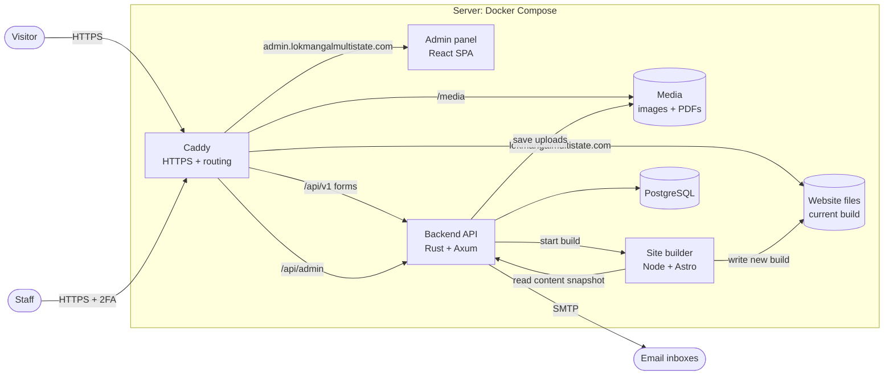
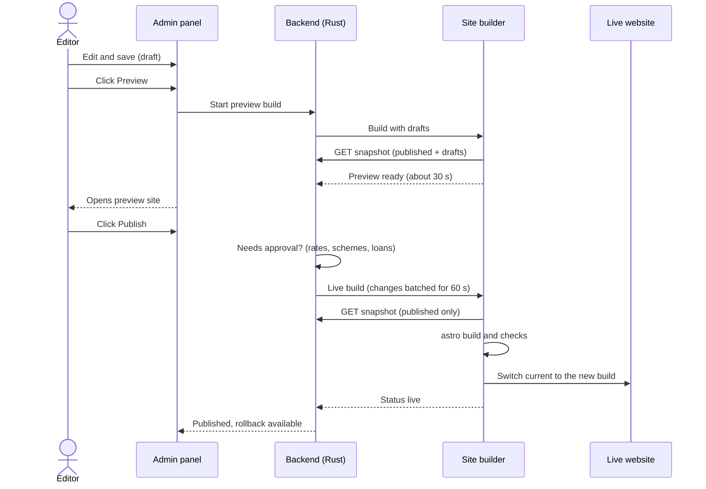
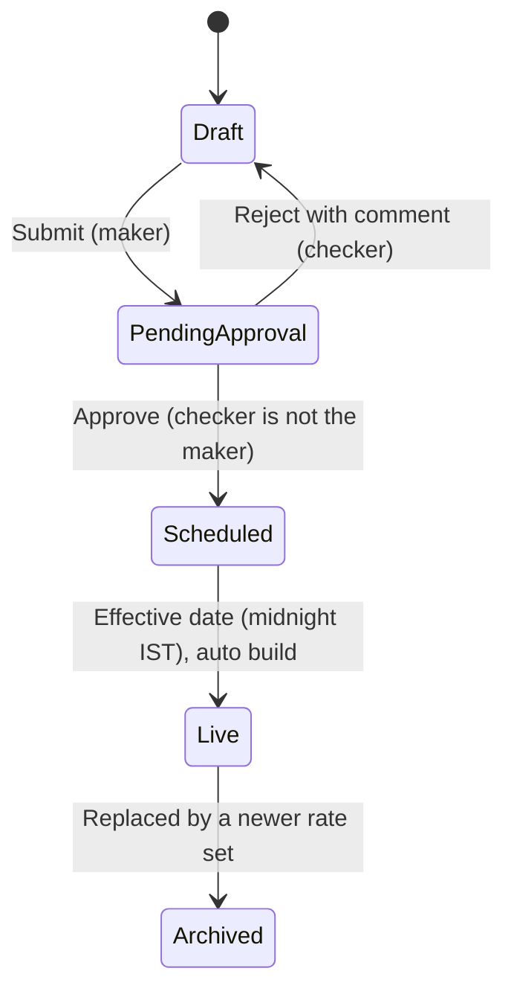
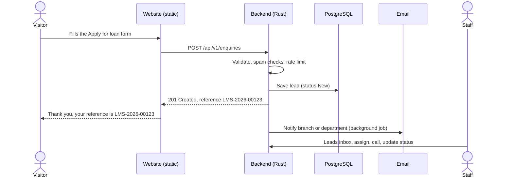

# Lokmangal Multistate: website, admin panel and API

> **Status: plan.** Today this repository holds only the public website (Astro), at the repo root. This document is the blueprint for turning it into three apps: **frontend** (public website), **admin** (staff panel) and **backend** (Rust API), all deployed with **Docker**. To run or deploy today's website, see [Appendix: the current website](#appendix-the-current-website).

## Contents

1. [Goals](#1-goals)
2. [Architecture at a glance](#2-architecture-at-a-glance)
3. [What the admin panel will have](#3-what-the-admin-panel-will-have)
4. [Roles and permissions](#4-roles-and-permissions)
5. [How it works: the main flows](#5-how-it-works-the-main-flows)
6. [Folder structure](#6-folder-structure)
7. [Tech stack](#7-tech-stack)
8. [Data model](#8-data-model)
9. [API design](#9-api-design)
10. [Security](#10-security)
11. [Deployment with Docker](#11-deployment-with-docker)
12. [Local development](#12-local-development)
13. [CI/CD, testing and monitoring](#13-cicd-testing-and-monitoring)
14. [Roadmap](#14-roadmap)
15. [Decisions needed from the society](#15-decisions-needed-from-the-society)

---

## 1. Goals

Staff should be able to update the website without a developer: interest rates, schemes, branches, notices, blog posts, photos. They should also be able to handle enquiries that come in through the website forms.

**Principles**

1. **The public website stays static.** Visitors get plain HTML files with no database, no login page and no plugins on the public domain. The old WordPress site was hacked, and a static site gives an attacker almost nothing to break into.
2. **Admins edit data, not design or formulas.** Page layouts and calculator formulas stay in code, where they are reviewed and tested. The admin panel only changes content.
3. **Each rate is entered once, as a number.** Today rates are also typed into text, as in "7 – 30 days: 3.50% p.a." or "Maturity ₹1,00,344". In the new system every rate is stored once as a number. All text, tables and maturity amounts are generated from that number, so the site can never show two different rates.
4. **Every change is previewed, published and reversible.** Nothing goes live until someone publishes it, every publish can be previewed first, and the previous version can be restored in one click.
5. **Two people sign off on money matters.** One person prepares a change to rates, schemes or loans and a different person approves it (maker–checker).
6. **Everything is logged.** The log records who changed what and when, with before and after values.
7. **Small and boring to run.** One server, one database and one `docker compose up`.

**Out of scope:** core banking. Accounts, balances and transactions stay in the society's core banking system and mobile app. The website and admin panel never connect to member accounts.

---

## 2. Architecture at a glance



| Address | What it serves | Who uses it |
| --- | --- | --- |
| `lokmangalmultistate.com` | Static website, plus `/media/*` uploads and `/api/v1/*` for forms | Public |
| `admin.lokmangalmultistate.com` | Admin panel, plus `/api/admin/*` | Staff (login + 2FA) |
| `preview.lokmangalmultistate.com` | The latest preview build, before it goes live | Staff, through a signed link from the admin panel |

**How content reaches visitors.** Staff edit content in the admin panel, and it is saved in PostgreSQL. When they click **Publish**, the builder downloads one JSON snapshot of all published content from the API and runs `astro build`. It then switches the live website to the new build. A visitor's request never touches the database, so the website stays fast and stays online even if the API is down.

---

## 3. What the admin panel will have

```
+----------------------+----------------------------------------------------------+
| LOKMANGAL ADMIN      | Search (Ctrl+K)            2 approvals    Admin v        |
+----------------------+----------------------------------------------------------+
| Dashboard            | Dashboard                            [ Publish website ] |
| Leads            12  |                                                          |
| Careers           3  | +----------+ +----------+ +----------+ +----------+      |
|                      | |New leads | |Approvals | |To publish| |Rates till|      |
| PRODUCTS             | |    12    | |    2     | |    5     | |31 Mar 27 |      |
|   Interest rates     | |  today   | | pending  | | changes  | |          |      |
|   Deposit schemes    | +----------+ +----------+ +----------+ +----------+      |
|   Loans              |                                                          |
|                      | Leads this week            Leads by branch               |
| WEBSITE              | Loan      ##########  18   Solapur   ########  9         |
|   Homepage           | Deposit   ######      11   Pune      #####     6         |
|   Pages & people     | Account   ####         7   Latur     ###       4         |
|   Blog / News        | Callback  ###          5   Kolhapur  ##        3         |
|   Gallery            |                                                          |
|   Notices & docs     | Recent activity                                          |
|   Branches           | 10:42  Rate set 2027-28 sent for approval                |
|   Media library      | 10:15  Blog post published: AGM 2026                     |
|   Navigation         | 09:58  Lead LMS-2026-00123 assigned to Pune              |
|   SEO & redirects    | 09:30  Website published (build #214, 41 s)              |
|                      |                                                          |
| PUBLISH              |                                                          |
|   Approvals        2 |                                                          |
|   Publish center     |                                                          |
|                      |                                                          |
| ADMIN                |                                                          |
|   Users & roles      |                                                          |
|   Audit log          |                                                          |
|   Settings           |                                                          |
+----------------------+----------------------------------------------------------+
```

### 3.1 Daily work

**1. Login and account security**
- Email and password, then a 6-digit code from Google or Microsoft Authenticator. 2FA is mandatory for everyone.
- Reset a forgotten password through a one-time email link that expires after 30 minutes.
- Automatic logout after 30 minutes idle and 12 hours at most. Users can see their active sessions and sign out any of them.

**2. Dashboard**
- Cards show new leads (today and this week), pending approvals, unpublished changes, the last publish (who, when, result) and the rate-validity end date.
- A warning appears 30 days before rates expire.
- Charts show leads by type and leads by branch.
- Also shown: follow-ups due today, scheduled posts and rate changes, and recent activity.

**3. Leads (website enquiries)**
- Covers every form on the website: open an account, apply for deposit, apply for loan, contact, request a callback and service enquiry.
- Inbox with filters by type, branch, status, date and assigned person, plus search by name or phone.
- The lead page shows every field, the source page, a timeline, internal notes and a follow-up date.
- Status flow: **New → Contacted → In progress → Converted / Not interested / Spam**.
- Leads can be assigned to a person or a branch. A lead from the same phone number within 30 days is flagged as a duplicate.
- Export to Excel or CSV. Only roles with permission can export, and every export is logged.
- Phone numbers are masked for roles without full lead access.
- Leads are deleted or anonymised automatically after the retention period set in Settings.

**4. Careers**
- Job openings: title, location, type, description and last date to apply. Open jobs appear on `/careers/` and in the position dropdown of the career form.
- Applications inbox with résumé download (HR only). Status flow: **New → Shortlisted → Interview → Selected / Rejected**.

### 3.2 Products: rates, deposits, loans

**5. Interest rates (rate sets)**
- A rate set holds every rate for one period, for example *2026–27*, valid 1 April 2026 – 31 March 2027. It includes:
  - FD slabs, for regular depositors and special categories
  - each scheme's rate
  - the Daam Duppat doubling period
  - loan rates
- One screen shows the whole set. To prepare next year, copy the current set and edit it.
- The changes view puts old and new values side by side, with changed cells highlighted.
- **Maker–checker:** *Submit for approval*, then a different person approves, then the set is scheduled. It goes live automatically at 00:00 on its effective date, and the old set is archived.
- The full history of every rate ever published is kept, which helps in audits and member queries.

**6. Deposit schemes**
- Fields:
  - name in English and Marathi
  - URL slug, locked once published so links and Google results keep working
  - type: FD, RD, monthly income or doubling
  - short pitch and introduction
  - key facts, features and eligibility
  - documents required and image
  - calculator defaults
  - "Featured on homepage" toggle and display order
- **The scheme form has no rate field.** Rates come from the active rate set. Text such as "Earn {rate}% p.a." fills itself in, and maturity amounts are calculated with the same formula the website calculators use.

**7. Loans**
- Name, icon, image, maximum amount and summary.
- A terms table: rate (from the rate set), margin, guarantors, membership, tenure and so on.
- A "Show in loan form" toggle.

### 3.3 Website content

**8. Homepage**
- Hero slides, each with image, heading, text, buttons, order and optional start and end dates.
- Stat counters (branches, deposits, business, members), the announcement bar, featured schemes, and switches to show or hide sections.

**9. Pages and people**
- Pages: About, Chairman's Message, Social Responsibility (initiatives), Other Services, Rural Wealth Manager, FAQ, Contact, Terms of Use and Privacy Policy.
- Rich-text editor for headings, lists, links, images and tables, plus SEO fields for each page.
- People: chairman, mentor and Board of Directors, with photo, designation and order.

**10. Blog / News**
- Posts in English or Marathi: title, slug, date, featured image, summary, body and category.
- Flow: **Draft → Scheduled → Published**. The 54 existing posts are imported.

**11. Gallery**
- Albums, bulk drag-and-drop upload, captions, cover photo and reordering.

**12. Notices and documents**
- Notices (election, AGM, public notices) with PDF attachments, a publish date, an expiry date and an optional pin to the announcement bar.
- Annual reports by year, member lists by district and downloadable forms.

**13. Branches**
- Regions and branches: name, address, phones, email, map location, timings, branch manager, and active or inactive.
- Head office details.
- Bulk import and export through Excel.
- The branch count on the homepage updates automatically, with an optional manual override.

**14. Media library**
- Images are converted to WebP in three sizes, and their hidden metadata is removed on upload.
- PDFs up to 50 MB.
- Alt text is required for every image, for accessibility.
- A "Where used" list for each file. *Replace file* keeps the same link. Files still in use cannot be deleted.

**15. Navigation and footer**
- Menu, mega-menu and footer links, with drag-and-drop ordering.

**16. SEO and redirects**
- Default title, description and share image, with overrides for each page.
- Redirects from an old URL to a new one (301 or 302), with a hit counter. Today's 23 legacy WordPress redirects move here.
- The sitemap and `robots.txt` are generated automatically.

### 3.4 Publishing and control

**17. Approvals**
- A queue of changes waiting for sign-off, each with a before and after view, and **Approve** / **Reject with comment** buttons.
- The person who made a change cannot approve it. The database enforces this, not just the screen.

**18. Publish center**
- Lists everything changed since the last publish.
- Buttons: **Preview**, **Publish now**, or schedule for later.
- Build history: who published, when, what changed, how long it took, the result and the build log.
- **Rollback** to any of the last 10 live versions in one click.

**19. Users and roles**
- Invite a user by email, then assign a role and, for branch staff, a branch.
- Deactivate users instead of deleting them, so the audit trail stays complete.
- Reset a user's 2FA and see their last login.

**20. Audit log**
- Every login, change, approval, export and publish: who did it, when, from which IP, with before and after values.
- Filter and export. The log is read-only, even for Super Admin.

**21. Settings**
- Organisation details: legal name, registration number, IFSC, phones, emails, address, map, app link and social links.
- The email recipients for each form type.
- The lead retention period and a maintenance banner.

---

## 4. Roles and permissions

Permissions are fine-grained, for example `rates.edit`, `rates.approve`, `leads.view.own_branch` and `site.publish`. A role is a named bundle of permissions, so the Super Admin can adjust roles without code changes. The starting roles:

| Module | Super Admin | Admin | Editor | Finance (maker) | Approver (checker) | Branch Manager | HR | Auditor |
| --- | --- | --- | --- | --- | --- | --- | --- | --- |
| Website content, blog, gallery, notices | Edit | Edit | Edit | View | View | — | — | View |
| Rates, schemes, loans | Edit | Edit | View | Edit | View | View | — | View |
| Approve rates, schemes, loans | Yes¹ | — | — | — | Yes¹ | — | — | — |
| Publish website | Yes | Yes | Request | — | Yes | — | — | — |
| Leads | All | All | — | — | View | Own branch | — | View (masked) |
| Lead export | Yes | Yes | — | — | — | Own branch | — | — |
| Careers and applications | Yes | Yes | — | — | — | — | Yes | View |
| Branches | Edit | Edit | — | — | — | Suggest change² | — | View |
| Users, roles, settings | Yes | — | — | — | — | — | — | — |
| Audit log | Yes | Yes | — | — | Yes | — | — | Yes |

¹ Never for a change the same person made. ² A branch manager's suggestion goes to Admin for approval.

---

## 5. How it works: the main flows

### 5.1 Editing and publishing content



1. Every content item has a **draft** version and a **published** version. *Save* writes the draft, so the live site does not change.
2. **Preview** builds the whole site with drafts included and opens it on the preview address. The preview is never indexed by search engines.
3. **Publish** copies the draft to the published version and queues a live build. Publishes made within 60 seconds of each other share one build.
4. The builder checks the result before switching: build succeeded, expected page count, every scheme has a rate. A failed check leaves the old site live, and admins get an email.
5. Going live is an **atomic symlink switch** to the new build folder. Visitors never see a half-built site, and **rollback** points the symlink back to an older build.
6. Every saved version is kept in a revision history, so any item can be restored to an earlier version.

### 5.2 Changing interest rates (maker–checker)



Example: in March 2027 the finance team copies *2026–27* to *2027–28*, changes the rates that move, and submits. The General Manager sees exactly which cells changed and approves. On 1 April 2027 at 00:00 the site rebuilds automatically. Every page, table, calculator and maturity example then shows the new rates, and the 2026–27 set is archived.

### 5.3 Website enquiry to lead



- Same-origin requests through Caddy, so no CORS setup is needed.
- Spam protection:
  - a hidden honeypot field and a minimum fill time, as today
  - per-IP rate limiting
  - an optional Cloudflare Turnstile check, switched on only if spam appears
- Forms gain a **Nearest branch** dropdown, so each lead goes straight to the right branch.
- If the API cannot be reached, the existing fallback still shows the visitor a pre-filled email and the phone number.

### 5.4 Signing in

Email and password are checked against an Argon2id hash. The user then enters the 2FA code. The server creates a session row and sets an `HttpOnly`, `Secure`, `SameSite=Strict` cookie (`__Host-` prefix, admin subdomain only). Every admin request is checked for session, CSRF header and permission, and the action is written to the audit log. After 5 failed attempts, logins are delayed with an increasing back-off, and the account owner is emailed.

---

## 6. Folder structure

```
lokmangal-multistate/
├── frontend/                    # PUBLIC WEBSITE: Astro, builds to static HTML
│   ├── src/
│   │   ├── components/          # Header, Footer, SchemeCard, EnquiryForm… (design unchanged)
│   │   ├── layouts/
│   │   ├── pages/
│   │   ├── scripts/             # main.ts: animations, calculators, forms
│   │   ├── styles/
│   │   └── lib/
│   │       ├── content.ts       # loads the content snapshot (from the API, or the seed file offline)
│   │       ├── finance.ts       # FD / RD / EMI formulas shared by calculators and scheme pages
│   │       └── api-types.ts     # generated from the backend's OpenAPI
│   ├── seed/
│   │   └── snapshot.json        # today's src/data content; offline dev + first import
│   ├── public/                  # fonts, icons and design images (uploads move to the media library)
│   ├── builder/
│   │   └── server.mjs           # small internal build service used in Docker
│   ├── astro.config.mjs
│   ├── Dockerfile
│   └── package.json
│
├── admin/                       # ADMIN PANEL: React + Vite + TypeScript
│   ├── src/
│   │   ├── app/                 # router, layout (sidebar + topbar), auth guard, providers
│   │   ├── components/          # DataTable, FormField, RichTextEditor, MediaPicker, DiffView…
│   │   ├── features/            # one folder per module (pages, forms, API hooks)
│   │   │   ├── auth/  dashboard/  leads/  careers/
│   │   │   ├── rates/  deposits/  loans/
│   │   │   ├── home/  pages/  people/  blog/  gallery/  notices/  branches/
│   │   │   ├── media/  navigation/  seo/
│   │   │   ├── approvals/  publish/
│   │   │   └── users/  audit/  settings/
│   │   └── lib/
│   │       ├── api.ts           # typed API client
│   │       ├── api-types.ts     # generated from the backend's OpenAPI
│   │       └── permissions.ts   # hides buttons a role cannot use (the API still enforces it)
│   ├── Dockerfile
│   └── package.json
│
├── backend/                     # API: Rust (Axum + SQLx + PostgreSQL)
│   ├── migrations/              # SQL migrations, applied automatically at start-up
│   ├── src/
│   │   ├── main.rs              # starts the HTTP server and the background worker
│   │   ├── bin/cli.rs           # lokmangal-cli: create-admin, import-seed, reset-2fa, export
│   │   ├── config.rs            # settings from environment variables
│   │   ├── app.rs               # router + middleware (tracing, limits, CSRF, rate limiting)
│   │   ├── error.rs             # one error type → consistent JSON errors
│   │   ├── auth/                # Argon2id passwords, sessions, TOTP 2FA, permissions
│   │   ├── content/             # generic content engine: drafts, revisions, publish
│   │   │   └── collections/     # one typed schema per content type: rate_set.rs, deposit_scheme.rs,
│   │   │                        #   loan.rs, branch.rs, post.rs, page.rs, notice.rs…
│   │   ├── approvals/           # maker–checker
│   │   ├── enquiries/           # public form intake + leads inbox
│   │   ├── careers/
│   │   ├── media/               # upload checks, WebP variants, private files
│   │   ├── publish/             # builds, preview, go-live, rollback, snapshot endpoint
│   │   ├── users/
│   │   ├── audit/
│   │   ├── dashboard/
│   │   ├── jobs/                # Postgres job queue: email, images, scheduled publishing, data retention
│   │   └── mail/                # email templates
│   ├── tests/                   # API tests against a throw-away database
│   ├── Cargo.toml
│   └── Dockerfile
│
├── deploy/
│   ├── compose.prod.yaml        # production stack
│   ├── Caddyfile                # HTTPS, domains, routing, security headers
│   ├── .env.example             # every setting the stack needs (real secrets never go in git)
│   └── scripts/
│       ├── deploy.sh            # pull new images, restart, health check
│       ├── backup.sh            # nightly database + media backup to off-site storage
│       └── restore.sh
│
├── docs/
│   ├── admin-guide.md           # how staff use the admin panel, with screenshots
│   ├── runbook.md               # what to do when something breaks
│   └── decisions/               # short records of important technical decisions
│
├── .github/workflows/
│   ├── ci.yml                   # lint, test and build all three apps on every push and PR
│   └── release.yml              # build Docker images → GHCR → deploy after approval
│
├── compose.yaml                 # local development: PostgreSQL + Mailpit (+ optional full stack)
├── justfile                     # shortcuts: just dev, just test, just types, just db-reset
└── README.md
```

Each backend module follows the same three-layer pattern: `routes.rs` handles HTTP, `service.rs` holds the business rules, and `repo.rs` holds the SQL. A developer who knows one module knows them all.

**Where today's content goes**

| Today (`src/data/…`) | Admin module | Stored as |
| --- | --- | --- |
| `site.ts`: contacts, address, IFSC, social links, `formEndpoint` | Settings | `settings` (single item) |
| `site.ts`: `stats`, homepage sections | Homepage | `home` (single item) |
| `site.ts`: `nav`, `footerLinks` | Navigation | `navigation` (single item) |
| `site.ts`: `notices`, `memberLists` | Notices and documents | `notices`, `documents` |
| `site.ts`: `gallery` | Gallery | `gallery_albums` |
| `deposits.ts`: rates, `fdSlabs`, `ratesValidity` | Interest rates | `rate_sets` (needs approval) |
| `deposits.ts`: schemes, documents, benefits | Deposit schemes | `deposit_schemes` (needs approval) |
| `loans.ts` | Loans | `loans` (needs approval) |
| `branches.ts` | Branches | `branches`, `regions` |
| `people.ts` | Pages and people | `people` |
| `faq.ts`, `services.ts`, `csr.ts` | Pages and people | `faqs`, `services`, `csr_initiatives` |
| `posts.json` | Blog / News | `posts` |
| `astro.config.mjs`: `legacyRedirects` | SEO and redirects | `redirects` |
| `public/api/enquiry.php` | Leads (replaced by the Rust API) | `enquiries` table |

The snapshot keeps the same shapes as today's `src/data` exports (`schemes`, `fdSlabs`, `loans`, `divisions`…). Most pages only need their import line changed, and the design stays exactly as it is.

---

## 7. Tech stack

| Layer | Choice | Why |
| --- | --- | --- |
| Public website | **Astro 7** (existing), static output | Already built. Fastest possible pages, with nothing on the server to attack. |
| Admin panel | **React 19 + Vite + TypeScript**. TanStack Router and Query, React Hook Form + Zod, shadcn/ui (Radix + Tailwind CSS), TanStack Table, TipTap editor, Recharts | Mature tools for forms, tables and rich text, and easy to hire for. |
| Backend | **Rust** (edition 2024): Axum, Tokio, SQLx, tower-http, tower-sessions, argon2, totp-rs, ammonia (HTML sanitising), image + webp, lettre (email), utoipa (OpenAPI), rust_xlsxwriter (Excel), tracing | Fast and memory-safe. SQL queries are checked at compile time, and it runs as a single small binary. |
| Database | **PostgreSQL 17** | Reliable, with JSONB for content, and also runs the job queue. No Redis needed. |
| Web server | **Caddy 2** | Automatic HTTPS certificates and a short, readable config. |
| Containers | **Docker + Docker Compose** | The same stack on a laptop and on the server. |
| CI/CD | **GitHub Actions + GitHub Container Registry** | The code already lives on GitHub. |
| Email | SMTP: the society's mail provider or Amazon SES. **Mailpit** for local testing | |

**Shared types.** The backend publishes an OpenAPI description at `/api/openapi.json`. `just types` generates TypeScript types from it for the admin panel and the frontend, so a change to an API field shows up as a compile error instead of a production bug.

---

## 8. Data model

There are two kinds of data.

**A. Website content: one generic content engine**

```
content_items      id, collection, slug, draft (jsonb), published (jsonb), status,
                   version, publish_at, requires_approval, updated_by, updated_at
content_revisions  id, item_id, version, data (jsonb), created_by, created_at
approvals          id, item_id, revision_id, requested_by, reviewed_by, status, comment,
                   CHECK (reviewed_by <> requested_by)
```

Each collection is defined once in Rust as a typed struct with validation rules: `rate_set`, `deposit_scheme`, `loan`, `branch`, `region`, `post`, `page`, `person`, `faq`, `service`, `csr_initiative`, `gallery_album`, `notice`, `document`, `job_opening`, `redirect`, `home`, `navigation` and `settings`. With this design, every content type gets drafts, preview, revisions, approvals and the audit trail without repeating code. A new content type is one struct plus one admin form, with no new tables.

**B. Operational data: regular relational tables**

```
users, roles, permissions, role_permissions, sessions
enquiries          id, reference, type, name, phone, email, city, branch_id, details (jsonb),
                   consent, status, assigned_to, follow_up_at, source_page, created_at
enquiry_notes      id, enquiry_id, user_id, note, created_at
job_applications   id, job_id, name, phone, email, resume_media_id, status, created_at
media              id, kind, file_name, mime, size, width, height, alt, sha256,
                   variants (jsonb), is_private, uploaded_by, created_at
builds             id, kind (preview|live), status, triggered_by, started_at, finished_at,
                   page_count, log, is_current
jobs               id, kind, payload (jsonb), run_at, attempts, status, last_error
audit_log          id, at, user_id, action, entity, entity_id, before, after, ip
                   (append-only: the app's database user cannot UPDATE or DELETE)
```

Times are stored in UTC and shown in IST (Asia/Kolkata). Content edits use **optimistic locking**: if two people edit the same item, the second save is refused with a "changed by someone else, reload" message instead of silently overwriting.

---

## 9. API design

- `/api/v1/…` is **public**: only form submissions and health checks.
- `/api/admin/…` is for **staff**: session cookie, CSRF header and permission check on every route.
- `/api/internal/…` is for the **builder only**: a secret token, and it is reachable only inside the Docker network because Caddy never routes it.
- JSON in and out. Lists accept `?page=`, `?per_page=`, `?q=` and `?sort=`.
- Errors always look like `{ "error": { "code": "validation", "message": "…", "fields": { "phone": "Enter a 10-digit number" } } }`.
- Interactive API docs at `/api/docs`, visible to admins only.

| Method and path | Purpose |
| --- | --- |
| `POST /api/v1/enquiries` | Website forms (replaces `enquiry.php`) |
| `POST /api/v1/applications` | Career form with résumé upload |
| `GET /api/v1/health` | Health check |
| `POST /api/admin/auth/login` · `/auth/2fa` · `/auth/logout` · `GET /auth/me` | Sign-in |
| `GET/POST/PUT/DELETE /api/admin/content/{collection}[/{id}]` | Edit any content type |
| `POST /api/admin/content/{collection}/{id}/publish` · `/submit` · `/revisions/{v}/restore` | Publish, request approval, restore a version |
| `GET /api/admin/approvals` · `POST /approvals/{id}/approve` · `/reject` | Maker–checker |
| `GET /api/admin/enquiries` · `PATCH /enquiries/{id}` · `POST /enquiries/{id}/notes` · `GET /enquiries/export` | Leads |
| `POST /api/admin/media` · `GET /api/admin/media` | Uploads and the media library |
| `POST /api/admin/builds` · `GET /builds` · `POST /builds/{id}/rollback` | Preview, publish, rollback |
| `GET /api/admin/dashboard` · `GET /api/admin/audit` | Dashboard and audit log |
| `GET/POST/PATCH /api/admin/users` · `/roles` | Users and roles |
| `GET /api/preview/login?token=…` · `GET /api/preview/check` | Staff access to the preview site through a short-lived signed link |
| `GET /api/internal/snapshot[?drafts=true]` | Everything the builder needs, in one JSON file |
| `POST /api/internal/builds/{id}/status` | Builder reports progress |

---

## 10. Security

The old site was hacked, so security is part of the design from day one.

**Separation**
- The public domain serves only static files and two public form endpoints. It has no login page.
- The admin panel lives on its own subdomain. Access can optionally be limited to office IP addresses.
- The database and builder have no public ports. Only Caddy listens on ports 80 and 443.

**Accounts**
- Passwords are hashed with Argon2id and must be at least 12 characters, checked against a list of common passwords.
- 2FA is mandatory. The 2FA secrets are encrypted in the database.
- Sessions are stored on the server, so they can be revoked instantly, and they have idle and absolute timeouts.
- Logins are rate-limited with back-off, and the owner is emailed about suspicious attempts.

**Requests**
- Cookies are `__Host-`, `HttpOnly`, `Secure` and `SameSite=Strict`, and state-changing requests also need a CSRF header.
- All SQL is parameterised (SQLx). Every input is validated on the server; validation in the admin panel is only a convenience.
- Rich text is cleaned with an allow-list (ammonia) before it is saved.
- Caddy adds security headers: Content-Security-Policy, HSTS, `X-Content-Type-Options`, `Referrer-Policy` and `frame-ancestors`.

**Uploads**
- The file type is checked from the file's actual contents, not its name, and size limits apply.
- Images are re-encoded, which strips any hidden payloads or metadata. SVG, HTML and executable files are not accepted.
- Files get random names. Private files such as résumés are never served directly, only through the API after a permission check.

**Operations**
- Secrets live only in the server's `.env` file, never in git.
- Containers run as non-root users with read-only file systems where possible.
- `cargo audit`, `cargo deny` and `npm audit` run in CI, and Dependabot keeps dependencies updated.
- **Use a new, clean server**, not the old WordPress server.
- Before go-live, have an independent security test (VAPT) done. That is normal practice for a financial institution.

**Personal data (India's DPDP Act, 2023)**
- Forms show a clear consent line that says what the data is used for.
- Forms collect only the fields that are needed.
- Leads are deleted automatically after the retention period.
- Access to leads is logged, backups are encrypted, and staff can export or delete one person's data on request.
- Have the consent text and retention period reviewed by the society's legal adviser.

---

## 11. Deployment with Docker

### 11.1 Server

- **One VPS:** 2 vCPU, 4 GB RAM and 80 GB SSD, running Ubuntu 24.04 LTS, in an India region (Mumbai or similar).
- **Firewall:** only ports 22, 80 and 443 open. SSH by key only, and automatic security updates switched on.
- **DNS:** A records for `@`, `www`, `admin` and `preview` pointing to the server.

### 11.2 Containers

| Service | Image | Job | Ports |
| --- | --- | --- | --- |
| `caddy` | `caddy:2` | HTTPS, routing, serves the website and media files | 80, 443 (only public ports) |
| `api` | `ghcr.io/…/lokmangal-api` | Rust API + background worker | internal 8000 |
| `builder` | `ghcr.io/…/lokmangal-site-builder` | Builds the Astro site on request | internal 4000 |
| `admin` | `ghcr.io/…/lokmangal-admin` | Serves the admin panel files | internal 8080 |
| `db` | `postgres:17-alpine` | Database | none |
| `backup` | `ghcr.io/…/lokmangal-backup` | Nightly encrypted backup to off-site storage | none |

**Volumes:** `pgdata`, `media` (public uploads), `private` (résumés), `site` (website builds), `caddy_data` (certificates).

**Images**
- `backend/Dockerfile` uses a multi-stage build with cargo-chef for fast cached builds. The final image is a small Debian-slim (or distroless) image with one binary, running as a non-root user.
- `frontend/Dockerfile` is Node 24 with the website source and dependencies baked in, plus `builder/server.mjs`.
- `admin/Dockerfile` runs a Node build stage, and the final image holds only the static admin files.

### 11.3 `deploy/compose.prod.yaml` (sketch)

```yaml
services:
  caddy:
    image: caddy:2
    ports: ["80:80", "443:443", "443:443/udp"]
    volumes:
      - ./Caddyfile:/etc/caddy/Caddyfile:ro
      - caddy_data:/data
      - site:/srv/site:ro
      - media:/srv/media:ro
    depends_on: [api, admin]
    networks: [edge]
    restart: unless-stopped

  api:
    image: ghcr.io/maheshofficelokmangalgroup-tech/lokmangal-api:${TAG}
    env_file: .env
    volumes:
      - media:/data/media
      - private:/data/private
    depends_on:
      db: { condition: service_healthy }
    networks: [edge, internal]
    restart: unless-stopped

  builder:
    image: ghcr.io/maheshofficelokmangalgroup-tech/lokmangal-site-builder:${TAG}
    environment:
      CONTENT_API: http://api:8000
      BUILD_TOKEN: ${BUILD_TOKEN}
    volumes:
      - site:/srv/site
    networks: [internal]
    restart: unless-stopped

  admin:
    image: ghcr.io/maheshofficelokmangalgroup-tech/lokmangal-admin:${TAG}
    networks: [edge]
    restart: unless-stopped

  db:
    image: postgres:17-alpine
    environment:
      POSTGRES_DB: lokmangal
      POSTGRES_USER: lokmangal
      POSTGRES_PASSWORD: ${POSTGRES_PASSWORD}
    volumes:
      - pgdata:/var/lib/postgresql/data
    healthcheck:
      test: ["CMD-SHELL", "pg_isready -U lokmangal"]
      interval: 10s
    networks: [internal]
    restart: unless-stopped

volumes: { caddy_data: {}, site: {}, media: {}, private: {}, pgdata: {} }

networks:
  edge: {}
  internal: { internal: true }   # no internet access, not reachable from outside
```

### 11.4 `deploy/Caddyfile` (sketch)

```caddyfile
(security_headers) {
	header {
		Strict-Transport-Security "max-age=31536000; includeSubDomains"
		X-Content-Type-Options nosniff
		Referrer-Policy strict-origin-when-cross-origin
		X-Frame-Options SAMEORIGIN
		# + a Content-Security-Policy that allows the Google Maps and YouTube embeds
	}
}

www.lokmangalmultistate.com {
	redir https://lokmangalmultistate.com{uri} permanent
}

lokmangalmultistate.com {
	encode zstd gzip
	import security_headers

	handle /api/v1/* {
		reverse_proxy api:8000
	}
	handle /media/* {
		root * /srv
		file_server
	}
	handle {
		root * /srv/site/current
		try_files {path} {path}/index.html
		file_server
	}
	handle_errors 404 {
		root * /srv/site/current
		rewrite * /404.html
		file_server
	}
}

admin.lokmangalmultistate.com {
	import security_headers
	handle /api/admin/* {
		reverse_proxy api:8000
	}
	handle {
		reverse_proxy admin:8080
	}
}

preview.lokmangalmultistate.com {
	header X-Robots-Tag "noindex, nofollow"
	handle /api/preview/* {
		reverse_proxy api:8000   # turns the signed link from the admin panel into a preview cookie
	}
	handle {
		forward_auth api:8000 {
			uri /api/preview/check
		}
		root * /srv/site/preview
		try_files {path} {path}/index.html
		file_server
	}
}
```

### 11.5 Environment variables (`deploy/.env.example`)

| Variable | Purpose |
| --- | --- |
| `TAG` | Image version to run, for example `2027.04.01-1` |
| `POSTGRES_PASSWORD`, `DATABASE_URL` | Database access |
| `PUBLIC_SITE_URL`, `ADMIN_URL` | Used for links in emails and origin checks |
| `SESSION_KEY` | Signs session cookies (64 random bytes) |
| `DATA_ENCRYPTION_KEY` | Encrypts 2FA secrets (32 random bytes) |
| `BUILD_TOKEN` | Shared secret between the API and the builder |
| `SMTP_HOST`, `SMTP_PORT`, `SMTP_USER`, `SMTP_PASSWORD`, `MAIL_FROM` | Outgoing email |
| `TURNSTILE_SECRET` | Optional CAPTCHA for forms |
| `BACKUP_REPOSITORY`, `BACKUP_PASSWORD` | Off-site backup target and encryption |
| `RUST_LOG` | Log level, usually `info` |

### 11.6 First deployment

```bash
# on the server
git clone https://github.com/maheshofficelokmangalgroup-tech/lokmangal-multistate.git
cd lokmangal-multistate/deploy
cp .env.example .env && nano .env                          # fill in secrets
docker compose -f compose.prod.yaml up -d
docker compose -f compose.prod.yaml exec api lokmangal-cli create-admin --email you@example.com
docker compose -f compose.prod.yaml cp ../frontend/seed/snapshot.json api:/tmp/snapshot.json
docker compose -f compose.prod.yaml exec api lokmangal-cli import-seed /tmp/snapshot.json
# open https://admin.lokmangalmultistate.com, sign in, set up 2FA, click "Publish website"
```

**Updates.** A merge to `main` builds new images in GitHub Actions and pushes them to GHCR. After someone approves the deployment in GitHub, `deploy.sh` runs `docker compose pull && docker compose up -d` on the server. Database migrations run automatically when the API starts, and a site rebuild is triggered so design changes go live too.

**Old URLs.** The 13 district voter-list PDFs (about 530 MB) currently at `/wp-content/uploads/2025/04/` are imported into the media library, and redirects keep the old links working.

### 11.7 Backups and recovery

- **Nightly:** an encrypted database dump plus the `media` and `private` volumes go to off-site storage in India. 7 daily, 4 weekly and 12 monthly copies are kept.
- **Monthly:** a restore test on a spare machine. A backup is only trusted once it has been restored.
- **Targets:** at most 24 hours of data loss, and service back within 4 hours on a fresh server (`restore.sh`).
- **If the API fails, the website stays up,** because it is plain files. Only forms fall back to "email us / call us".

**Hosting on Render instead.** Render can run the API as a Docker service with Render PostgreSQL, and the website and admin as Render static sites. In that setup Publish calls Render's deploy hook instead of the builder. It works, but preview and rollback depend on Render, the monthly cost is higher, and data residency is less clear. The single Docker server above is recommended.

---

## 12. Local development

Requirements: Docker Desktop, Rust (stable, via rustup), Node.js 24 and `just` (optional).

```bash
docker compose up -d                 # PostgreSQL :5432 + Mailpit (email viewer) :8025

cd backend
cargo run                            # API on http://localhost:8000 (runs migrations)
cargo run --bin lokmangal-cli -- create-admin --email dev@example.com
cargo run --bin lokmangal-cli -- import-seed ../frontend/seed/snapshot.json

cd admin && npm install && npm run dev       # http://localhost:5173 (proxies /api → :8000)
cd frontend && npm install && npm run dev    # http://localhost:4321
```

The frontend reads content from `CONTENT_API` when it is set and falls back to `seed/snapshot.json` otherwise, so the website can be worked on with no backend at all. Every email the API sends locally shows up in Mailpit at http://localhost:8025 and is never really sent.

---

## 13. CI/CD, testing and monitoring

**On every push and pull request (`ci.yml`)**
- **backend:**
  - `cargo fmt --check`, `cargo clippy -- -D warnings`
  - `cargo test` against a PostgreSQL service container
  - `cargo sqlx prepare --check`, `cargo audit`, `cargo deny`
- **admin:** lint, type-check, Vitest unit tests, production build.
- **frontend:** type-check and a build from the seed snapshot. The page count must not drop, and internal links must resolve.
- **end-to-end** (Playwright, on the full Docker stack): sign in with 2FA, edit a rate, have a second user approve it, publish, then check the live page shows the new rate. Submit a form and confirm the lead appears in the inbox.

**Key tests**
- Calculator formulas match the published leaflet figures. Example: Lakshadish 1 matures at ₹1,00,344.
- A maker cannot approve their own change.
- Every admin route rejects users without the right permission.
- Uploads with a fake file type are rejected.

**Monitoring**
- Docker health checks on every service, and an external uptime monitor for the website, admin and `/api/v1/health`.
- Email alerts for a failed build, a failed backup, high disk usage or repeated login failures.
- The API writes structured JSON logs (`tracing`), kept for 30 days.

**Performance targets**
- The public site stays as fast as today, because it is still static files.
- 95% of API responses in under 100 ms.
- A full site build in under 60 seconds.

---

## 14. Roadmap

Rough durations for one experienced full-stack developer; two developers can work on the phases in parallel.

| Phase | What gets built | Done when | Time |
| --- | --- | --- | --- |
| **0. Restructure** | Move the site into `frontend/` (`git mv`, so history is kept). Point `render.yaml` at `rootDir: frontend`. Add `frontend/src/lib/finance.ts` and the seed snapshot. | The site builds byte-for-byte the same and Render still deploys it | 2 days |
| **1. Backend foundation** | Axum skeleton, config, PostgreSQL, migrations, sign-in with 2FA, users and roles, audit log, `compose.yaml`, CI | An admin can sign in, and every action is logged | 2 weeks |
| **2. Leads** | `POST /api/v1/enquiries`, email notifications, the leads inbox in the admin panel, Excel export. `enquiry.php` is retired. | A website form shows up as a lead with a reference number | 1 week |
| **3. Content engine and products** | Drafts, revisions, approvals, the snapshot endpoint, builder, preview, publish, rollback. Settings, Homepage, Rates (maker–checker), Deposit schemes, Loans, Branches, People, FAQ, Services, CSR. | A rate change is approved and goes live by itself on its effective date | 3 weeks |
| **4. Media and editorial** | Media library, Blog (54 posts imported), Gallery, Notices and documents, Pages, Navigation, SEO and redirects, Careers | All of today's `src/data` content is editable in the admin panel | 2.5 weeks |
| **5. Production and go-live** | Production server, Caddy, backups and restore test, monitoring, security test (VAPT), staff training and the admin guide, DNS switch, shutting down the old server | The website runs on the new server and the old WordPress server is switched off | 1 week |
| **6. Later (optional)** | Marathi version of the site, SMS or WhatsApp confirmations (needs TRAI DLT registration), branch locator map, reports | — | — |

**Total: about 10 weeks** to a full go-live. The public website keeps working on Render the whole time, and Phase 2 already gives working forms on the new server.

---

## 15. Decisions needed from the society

1. **Who uses the admin panel?** List the people and their roles. Who is the *Approver* for rate changes?
2. **Branch managers:** should all 60+ branch managers get logins to see their own branch's leads?
3. **Email:** which mail service sends the notifications (the existing domain mailbox or Amazon SES), and which inbox receives each form type?
4. **Server:** which provider and budget, and who controls the domain's DNS?
5. **Lead retention:** how long are leads kept before automatic deletion (for example 24 months)?
6. **Admin access:** from anywhere with 2FA, or only from office networks?
7. **Marathi website:** needed at launch, or later (Phase 6)?
8. **SMS or WhatsApp confirmations** to visitors: wanted? (They need DLT registration and a provider.)

---

## Appendix: the current website

Until Phase 0, the Astro website lives at the repository root.

```bash
npm install
npm run dev        # http://localhost:4321, live preview while editing
npm run build      # finished website in dist/
npm run preview    # serves dist/ to check the build
```

Requires Node.js 22.12 or newer.

**Updating content today.** All content lives in `src/data/`:

| File | What it holds |
| --- | --- |
| `site.ts` | Contacts, address, IFSC, social links, stats, navigation, notices, gallery |
| `deposits.ts` | Schemes, FD slabs and rate validity |
| `loans.ts` | Loans |
| `branches.ts` | Branches |
| `people.ts` | Board and chairman |
| `faq.ts` | FAQ |
| `services.ts` | Services and Rural Wealth Manager |
| `csr.ts` | Social responsibility |

Images live in `public/images/` and PDFs in `public/docs/`. `npm run import:blog` re-imports posts from the old WordPress site (genuine "Blog" category only). Add `-- --full` to import the full text too.

**Forms today.** Forms post to `public/api/enquiry.php`, which needs a PHP host. On Render (no PHP), visitors get the "email us / call us" fallback instead.

**Render.** Sign in at render.com with GitHub, then **New + → Blueprint**, choose this repository, and click **Apply**. Render runs `npm ci && npm run build` and publishes `dist/`, and every push to `main` redeploys the site.

**Own server (PHP + nginx).** Upload the contents of `dist/`. Configure nginx with `try_files $uri $uri/ $uri/index.html =404;` and `error_page 404 /404.html;`, and route `/api/*.php` to PHP-FPM. Old WordPress URLs redirect automatically (see `astro.config.mjs`). Keep `/wp-content/uploads/2025/04/` on the server, because the district voter-list PDFs are linked from there.

**Before going live**
- **Secure the old server before reusing it.** Content from the old WordPress site was reviewed and only genuine pages and posts were carried over. Reset all WordPress, hosting and FTP passwords, and have the server checked before reusing it.
- Have someone review the rewritten page text, especially the Chairman's Message, Terms of Use and Privacy Policy.
- The figures come from the 2026–27 leaflets: 60 branches, ₹751+ Cr deposits, ₹1195+ Cr business, and rates valid until 31 March 2027.
- Annual reports from 2017–18 onwards were never uploaded to the old site. Add them to `public/docs/` and link them in `src/pages/annual-reports.astro`.
