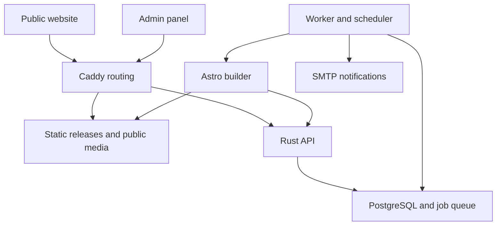
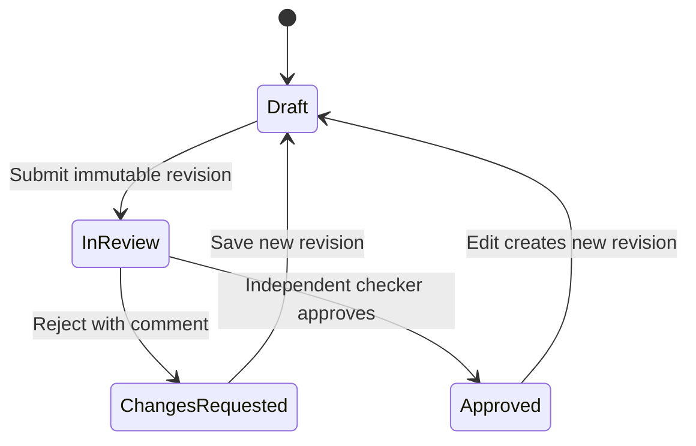
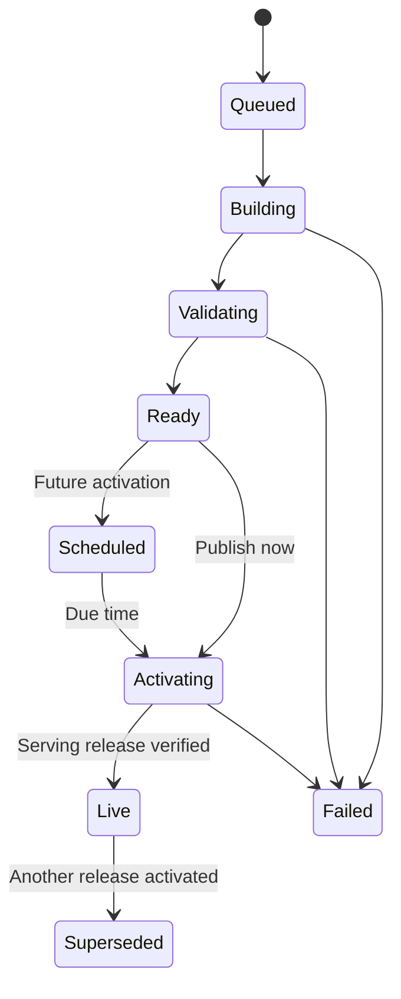

# Lokmangal Multistate — Website, Admin Panel & Rust API

> **Master implementation prompt and product specification**  
> **Document version:** 2.0 · **Prepared:** 27 October 2026  
> **Status:** Proposed implementation; the application described here has not been built or verified by this document.  
> **Priority:** A polished, practical admin panel with complete workflows and a reliable connection to the existing public website.

## How to use this README

Give this entire file to the developer or coding agent working in the Lokmangal Multistate repository. Ask it to follow the execution instructions below and implement the project in phases. Keep this file at the repository root as the agreed specification.

**हा README coding agent किंवा developer ला द्या. यामध्ये admin panel चे design, screens, features, backend, publishing, security आणि acceptance criteria दिले आहेत.**

This specification is based on the supplied **“Lokmangal Multistate: website, admin panel and API”** document. It preserves the existing Astro website, Rust backend direction, PostgreSQL database and Docker deployment. It adds detailed admin design requirements and resolves ambiguities around approvals, scheduled rates, releases, private uploads and migration.

Names, figures and file counts from the supplied document are migration inputs to verify. They are not newly verified facts about the society.

## Contents

1. [Master instruction](#1-master-instruction)
2. [Product scope and non-negotiable rules](#2-product-scope-and-non-negotiable-rules)
3. [Architecture and technology](#3-architecture-and-technology)
4. [Admin visual design system](#4-admin-visual-design-system)
5. [Navigation and routes](#5-navigation-and-routes)
6. [Shared interaction patterns](#6-shared-interaction-patterns)
7. [Screen-by-screen requirements](#7-screen-by-screen-requirements)
8. [Roles and permissions](#8-roles-and-permissions)
9. [Rates, calculations and financial content](#9-rates-calculations-and-financial-content)
10. [Drafts, approvals, previews and publishing](#10-drafts-approvals-previews-and-publishing)
11. [Data model and background jobs](#11-data-model-and-background-jobs)
12. [API contract](#12-api-contract)
13. [Security and personal data](#13-security-and-personal-data)
14. [Deployment, backups and monitoring](#14-deployment-backups-and-monitoring)
15. [Migration from the existing website](#15-migration-from-the-existing-website)
16. [Repository and local development](#16-repository-and-local-development)
17. [Testing and acceptance criteria](#17-testing-and-acceptance-criteria)
18. [Implementation phases and handover](#18-implementation-phases-and-handover)
19. [Business inputs and technical references](#19-business-inputs-and-technical-references)

---

## 1. Master instruction

**Act as a senior product designer, frontend engineer, Rust backend engineer and technical lead for this project.**

Build a complete content and enquiry management system for **Lokmangal Multistate** with three applications:

- **frontend/** — the existing Astro public website, delivered as static HTML.
- **admin/** — a new React and TypeScript staff panel.
- **backend/** — a Rust API using Axum and PostgreSQL.

Create a premium orange-and-white admin interface that staff can understand without technical training. Give equal attention to typography, information hierarchy, forms, tables, error recovery and real backend behavior.

### Execution rules for the implementing developer

1. Inspect the repository, its instructions, package manifests, lockfiles, source data, routes, forms and deployment configuration before changing structure.
2. Identify what already works. Preserve the public site's approved design, routes, language content, metadata, downloadable files and calculators during the migration.
3. Record a short implementation plan and a baseline of existing routes and content. Use the actual code as evidence for dependency versions and existing behavior.
4. Build shared design components first, then implement complete workflows one module at a time.
5. Connect finished modules to the real API and database. Development fixtures must be isolated and visibly labelled.
6. Implement authorization on the server. Hiding a button is only a user-interface convenience.
7. Every visible action must work or clearly explain why it is unavailable. Never show a successful save, upload, approval or publish before the server confirms it.
8. Keep business rules in services and typed schemas. Avoid a single giant React component or a generic unvalidated JSON editor.
9. Use reasonable documented defaults for reversible design choices. Track missing society decisions in a configuration checklist while continuing independent implementation.
10. Complete meaningful tests, production builds, migration checks and documentation. Report what passed, what failed and what remains blocked.
11. Do not claim production readiness using screenshots alone. Demonstrate persistence, permissions, publishing and recovery.
12. Keep the backend in Rust and the public site in Astro. Changing these foundations requires an explicit project decision.

**The required result is a usable staff product: well-designed screens, complete workflows, consistent data, secure access and an operational handover.**

## 2. Product scope and non-negotiable rules

### Business outcome

Staff should update public content, process enquiries, maintain branches and careers, and publish approved changes without asking a developer to edit source files.

### Included

- Mandatory staff authentication and two-factor authentication.
- Dashboard, leads inbox, follow-ups and careers.
- Interest rates, deposit schemes and loans.
- Homepage, pages, people, news, gallery, notices and documents.
- Branches, media, navigation, SEO and redirects.
- Approval queue, preview, scheduling, publishing and rollback.
- Users, roles, audit records, settings and operational status.
- Import of existing site content and protection of existing URLs.
- Docker deployment, backups, restore procedure, monitoring and staff guidance.

### Outside this project

Core banking, account balances, transaction processing, payments, KYC collection, member account authentication and access to banking databases are outside this scope. Public application forms create enquiries; they do not open accounts or approve loans.

Full Marathi translation of the public website is a configurable launch decision. Marathi content entry and correct Devanagari rendering are required from the start.

### Non-negotiable rules

| Rule | Required behavior |
| --- | --- |
| Public pages remain static | Browsing pages does not query the application database. Forms use the Rust API. |
| Content and design remain separate | Staff edit approved content fields. Layouts, executable scripts and calculator logic remain in reviewed code. |
| Rates have one source | Rate tables, product text, examples and calculators resolve the same versioned rate data. |
| Drafts remain private | Saving changes never silently changes the live site. |
| Financial changes require two people | The maker and checker must be different people, including for Super Admin. |
| Approval belongs to a revision | Editing approved content invalidates that approval for the new revision. |
| Publication is a release | A successful build and activation determine what is live. Saving or approving content alone does not. |
| Recovery preserves consistency | Rollback restores a complete website release, including its content snapshot and media references. |
| Personal data stays private | Leads, applicant information, résumés and internal notes never enter the public build snapshot. |
| Availability has clear limits | Static pages can survive an API outage while the host and web server remain healthy; forms still depend on the API. |
| Every material action is traceable | Changes, approvals, access to sensitive records, exports, publishes and security actions are logged. |
| Administration is usable | All important screens have loading, empty, error, permission, validation and success states. |

## 3. Architecture and technology

### 3.1 Proposed domains

Verify domain ownership and DNS before deployment. These hostnames come from the supplied plan.

| Address | Responsibility |
| --- | --- |
| `lokmangalmultistate.com` | Static website, published public media and allowlisted public form endpoints |
| `www.lokmangalmultistate.com` | Permanent redirect to the canonical public host |
| `admin.lokmangalmultistate.com` | Staff application and same-origin admin API |
| `preview.lokmangalmultistate.com` | Authenticated, short-lived access to a specific preview release |

### 3.2 System topology



The diagram shows logical responsibilities. The API and worker can use the same Rust codebase and container image, with separate process commands. No Redis or separate message broker is required for the initial implementation.

### 3.3 Technology choices

| Layer | Project choice | Implementation requirement |
| --- | --- | --- |
| Public website | Existing Astro + TypeScript | Keep static output and preserve established templates. |
| Admin | React + Vite + TypeScript | Strict types, route-based loading and a consistent application shell. |
| Routing and remote state | TanStack Router and TanStack Query | Typed routes, URL-backed filters and controlled cache invalidation. |
| Forms | React Hook Form + Zod | Accessible client validation paired with authoritative server validation. |
| UI primitives | shadcn/ui, Radix and Tailwind CSS | Customize tokens and compositions to the design system below. |
| Tables | TanStack Table | Server-side filtering, sorting and pagination where datasets can grow. |
| Editorial content | TipTap | Restrict to approved content structures; sanitize server-side. |
| Charts and icons | Recharts and Lucide | Small, purposeful charts and one consistent outline icon set. |
| Backend | Rust, Axum, Tokio, SQLx | Layered routes, services and repositories; parameterized queries. |
| API contract | OpenAPI generated from Rust types | Generate TypeScript client types and check drift in CI. |
| Database and jobs | PostgreSQL | Relational operational data, typed JSONB editorial content and durable jobs. |
| Edge | Caddy | HTTPS, host-specific routing, static files and preview authentication. |
| Packaging | Docker Compose | Reproducible development and production configurations. |
| Mail | SMTP; Mailpit locally | Notifications queued after database commits. |
| Tests | Rust integration tests, Vitest, Playwright | Cover business rules and real user workflows. |
| CI and registry | GitHub Actions and GHCR when the repository uses GitHub | Versioned images and a documented release process. |

**Version policy:** The original plan mentions Astro 7, React 19, PostgreSQL 17 and Node 24. Treat these as proposed baselines. Inspect the actual repository, confirm compatibility and pin supported versions in manifests, lockfiles, toolchain files and images. Do not upgrade the public site merely to match a number in this document.

### 3.4 Boundaries that must remain explicit

- The public host exposes only the public routes listed in the API contract.
- Admin routes are unavailable through the public host.
- Internal snapshot and builder routes are unreachable through every public-facing host.
- The database, worker and builder have no publicly bound ports.
- The builder reads a frozen, allowlisted snapshot; it never reads operational tables directly.
- Public release files and private preview files use separate storage roots and access rules.
- Caddy mounts published files read-only. A restricted release controller manages activation.
- The builder executes fixed commands with validated arguments and has no Docker socket access.

## 4. Admin visual design system

### 4.1 Visual direction

Design a calm, precise administration workspace for a cooperative financial institution. Use **orange accents, white surfaces, warm neutral backgrounds, clear tables and restrained borders**.

The interface should feel tailored to Lokmangal. Use the approved logo and real content labels. Prioritize the everyday tasks of branch staff, editors and finance reviewers.

Avoid decorative dashboard clutter, oversized welcome banners, excessive shadows, glass effects, animated backgrounds, ornamental 3D icons and invented performance figures.

### 4.2 Design tokens

The following values are design defaults, not a substitute for contrast testing.

| Token | Value | Use |
| --- | --- | --- |
| Brand primary | `#C2410C` | Primary buttons, active indicators and important links |
| Brand hover | `#9A3412` | Hover and pressed primary actions |
| Brand accent | `#EA580C` | Small graphic accents and selected data emphasis |
| Brand soft | `#FFF7ED` | Selected navigation background and gentle highlights |
| Canvas | `#F7F8FA` | Main application background |
| Surface | `#FFFFFF` | Sidebar, topbar, tables, dialogs and forms |
| Text primary | `#18181B` | Headings and primary values |
| Text secondary | `#52525B` | Labels, descriptions and secondary values |
| Border | `#E4E4E7` | Dividers and subtle surface outlines |
| Success | `#166534` | Live, approved and completed states |
| Warning | `#92400E` | Pending, approaching expiry and review states |
| Destructive | `#B91C1C` | Errors, failed releases and destructive actions |
| Neutral status | `#52525B` | Draft, archived and inactive states |

Use semantic CSS variables for these tokens. Status always includes readable text or an icon with an accessible label; color alone must not communicate meaning.

### 4.3 Typography and spacing

- Use **Poppins** for concise headings and English navigation; use **Mukta** for Marathi and mixed-language content. Self-host approved font files where practical.
- Keep dense table text highly legible. Use tabular numerals for rates, currency and counts.
- Page title: approximately 26–28 px, weight 600.
- Section title: approximately 17–18 px, weight 600.
- Body and form controls: 14–16 px. Main Devanagari body text: at least 16 px.
- Metadata: 12–13 px, with sufficient contrast.
- Use a 4 px spacing scale: 4, 8, 12, 16, 24 and 32 px.
- Default panel radius: 10 px; inputs and buttons: 8 px. Reserve pill shapes for compact statuses.
- Use borders for structure; use subtle shadows mainly for menus, dialogs and floating elements.
- Default form control height: 42–44 px. Use comfortable touch targets for mobile controls.
- Default table row height: about 48 px, with a user-selectable compact density.

### 4.4 Application shell

| Area | Desktop specification |
| --- | --- |
| Sidebar | 248 px wide, white, thin right border, grouped navigation, current section highlighted in soft orange |
| Collapsed sidebar | About 76 px, accessible tooltips and a visible expand control |
| Topbar | 64 px high; breadcrumbs, command search, notifications, help and account menu |
| Main content | 24–32 px padding; fluid width for tables |
| Page header | Title, short context line, count or state, then a clear primary action |
| Main action area | One visually dominant action; secondary actions grouped beside it |
| Editor | Main form with a narrower right-side summary panel on large screens |
| Save controls | Sticky action bar when needed, positioned so it never covers fields or focused elements |
| Footer metadata | Build/version information in account/help areas, not dominating daily workflows |

Use table sections and separators for dense operational data. Reserve cards for dashboard summaries, preview tiles and distinct tasks.

### 4.5 Responsive behavior

| Width | Required adaptation |
| --- | --- |
| 1440 px and wider | Full sidebar, multi-column dashboard, editor with summary panel |
| 1024–1439 px | Collapsible sidebar, compact header actions and two-column dashboard |
| 768–1023 px | Drawer navigation, stacked editor summary, reduced table columns with a detail action |
| Below 768 px | Single-column forms, full-width primary actions and mobile-friendly record views |

Do not squeeze all desktop columns into a phone screen. Keep the name/reference, status and primary action visible; move secondary details into the record view. A genuinely wide rate matrix may scroll horizontally inside a labelled region without making the whole page overflow.

### 4.6 Accessibility and motion

- Target WCAG 2.2 AA and verify with automated checks plus manual keyboard use.
- Provide visible focus, logical tab order, semantic headings, labels and error associations.
- Dialogs and drawers trap focus, return focus to the opener and close predictably.
- Drag-and-drop ordering also offers keyboard-accessible move controls.
- Charts have a textual summary or equivalent table.
- Use transitions around 120–180 ms and respect reduced-motion preferences.
- Do not depend on hover to expose essential actions.
- Support 200% zoom and long Marathi text without clipping essential controls.

## 5. Navigation and routes

Show only the modules the signed-in user can access. Counts must follow that user's permissions and branch scope.

| Navigation group | Menu item | Admin route |
| --- | --- | --- |
| Workspace | Dashboard | `/dashboard` |
| Workspace | Leads | `/leads` |
| Workspace | Careers | `/careers/jobs`, `/careers/applications` |
| Products | Interest rates | `/products/rates` |
| Products | Deposit schemes | `/products/deposits` |
| Products | Loans | `/products/loans` |
| Website | Homepage | `/website/homepage` |
| Website | Pages and people | `/website/pages`, `/website/people` |
| Website | Blog and news | `/website/posts` |
| Website | Gallery | `/website/gallery` |
| Website | Notices and documents | `/website/notices`, `/website/documents` |
| Website | Branches | `/website/branches` |
| Website | Media library | `/website/media` |
| Website | Navigation and footer | `/website/navigation` |
| Website | SEO and redirects | `/website/seo`, `/website/redirects` |
| Publishing | Approvals | `/approvals` |
| Publishing | Publish center | `/publish` |
| Administration | Users and roles | `/admin/users`, `/admin/roles` |
| Administration | Audit log | `/admin/audit` |
| Administration | Settings | `/admin/settings` |
| Account | Profile, 2FA and sessions | `/account/security` |

Login, reset password, invitation acceptance and 2FA setup are separate authentication routes. The public website must not expose an admin login page in its own route tree.

## 6. Shared interaction patterns

### 6.1 Reusable components

Build and document these components before duplicating page-specific markup:

- AppShell, Sidebar, Topbar, Breadcrumbs and PageHeader.
- DataTable, TableToolbar, FilterBar, SavedView and Pagination.
- StatusBadge, MetricSummary, ActivityTimeline and EmptyState.
- FormField, CurrencyInput, PercentageInput, DateTimeInput and LocalizedTextField.
- RichTextEditor, MediaPicker, UploadQueue and ImageCropPreview.
- RecordDrawer, ConfirmDialog and PermissionMessage.
- RevisionHistory, FieldDiff, ApprovalPanel and PublishChecklist.
- ErrorSummary, InlineAlert, Skeleton, Toast and UnsavedChangesGuard.

Use one consistent way to render each pattern across every module.

### 6.2 Tables

Each operational table must support:

- Search with a short debounce, clear filters and a visible result count.
- Server-side pagination with 25, 50 and 100 rows per page.
- Sortable, allowlisted columns and stable ordering.
- Filter state in the URL so a view can be bookmarked.
- Persistent column visibility and density preferences per user.
- Named row actions; do not rely only on unlabeled icons.
- Bulk actions only where the user's permission applies to every selected record.
- Clear distinction between “selected on this page” and “all filtered results.”
- A readable empty state with an action appropriate to the user's role.
- Retry after a load failure without losing the selected filters.
- Export of the current authorized filter scope, not an unfiltered database dump.

### 6.3 Forms and editors

- Group fields by task with clear labels, short helper text and required-field indicators.
- Validate on the client for convenience and on the server for correctness.
- On submit failure, retain the user's values and focus the first invalid field.
- Display a summary for multiple errors and inline messages beside fields.
- Warn before leaving an unsaved form.
- Use explicit Save draft as the baseline. If autosave is added, show Saving, Saved with time, or Save failed, and use revision locking.
- Do not cache leads, résumés or sensitive form values in browser local storage.
- On a revision conflict, show the new server version and the user's changes; allow comparison and intentional reapplication.
- Keep Save draft, Submit for approval, Preview and Publish distinct.
- Include author, last updated time, revision number and publication state where relevant.
- Show localized fields through English/Marathi tabs with a completeness indicator.
- An empty translation must not silently become a published translation.

### 6.4 States and feedback

| Situation | UI behavior |
| --- | --- |
| First load | Skeleton matching the actual screen structure |
| No records yet | Short explanation and a permitted creation action |
| No filter matches | Clear filters action; do not suggest the database is empty |
| Request failed | Human-readable message, retry and a support reference |
| Session expired | Return to authentication with a safe internal return path |
| Forbidden action | Explain the missing permission without exposing restricted data |
| Long operation | Progress from the backend and an operation identifier |
| Saved successfully | Subtle confirmation with updated server state |
| Conflict | Comparison view and reload/reapply choices |
| Partial bulk failure | Per-record results and retry for failed records only |
| API unavailable | Visible connection state; no fake success or silent deletion of input |

### 6.5 Search, notifications and language

- Ctrl/Cmd+K opens a command palette for accessible modules and permitted records.
- Search results, previews and counts apply the same permissions as ordinary pages.
- The notification menu shows approval requests, follow-ups, failed releases and relevant rate warnings.
- Each notification links to the affected record and supports read/unread status.
- Polling or server-sent events may update job progress; pause unnecessary background polling.
- Display staff timestamps in Asia/Kolkata and label scheduled times clearly.
- Use Indian number formatting for rupee values, for example ₹1,00,000.
- Translate interface strings through a dictionary structure; English is the initial default.

## 7. Screen-by-screen requirements

All 21 modules below are required for the complete scope. The phase plan determines their implementation order.

### 7.1 M01 — Login and account security

**Layout:** A restrained branded panel beside a compact login form on desktop; a single-column form on mobile. Use the approved logo and a plain background.

**Screens:** Login, 2FA challenge, first-time 2FA enrollment, backup codes, forgot password, reset password, invitation acceptance and active sessions.

**Behavior:**

- Email and password followed by mandatory TOTP verification.
- First-time enrollment shows a QR code and manual setup key, then requires a valid code.
- Issue one-time recovery codes; show them once and store only protected verifiers.
- Password reset links are single use and expire after 30 minutes.
- Idle timeout defaults to 30 minutes; absolute session lifetime is 12 hours.
- Warn shortly before idle expiry and offer a deliberate continue-session action.
- A session list shows approximate device information, creation time and last activity.
- Let users revoke other sessions and sign out everywhere.
- Password reset, account deactivation and 2FA reset invalidate applicable sessions.
- Protect the last active Super Admin from accidental deactivation.
- A 2FA reset requires a verified administrative process, recent authentication and an audit entry.

**Acceptance:** No protected data is accessible before completing both factors; revoked sessions immediately lose access.

### 7.2 M02 — Dashboard

**Purpose:** Tell staff what needs attention and whether the public site is up to date.

**Desktop composition:**

| Position | Content | Interaction |
| --- | --- | --- |
| Header | Dashboard, date range and branch scope | View website and permission-aware Publish website |
| First row | New leads, follow-ups due, pending approvals, changes awaiting release | Each summary opens its filtered list |
| Main left | Leads over time with type filters | Accessible chart and table alternative |
| Main right | Leads by branch | Ranked bars with exact counts |
| Action area | Follow-ups, approvals and scheduled changes | Direct links to actionable records |
| Publishing area | Live release, last build result and rate validity | Open publish history or rates |
| Bottom | Recent activity | Relevant events with readable descriptions |

Additional rules:

- Default to the last 7 days; offer today, 30 days and a custom range.
- Define counts consistently: “new leads” uses lead creation time; “follow-ups due” excludes closed leads.
- Show each user's authorized scope in the header.
- Branch staff see their own branch; HR sees recruitment work; finance sees approvals and rates.
- Rate warnings begin 30 days before expiry, with stronger warnings at 7 days and at expiry.
- Empty charts show “No enquiries in this period.”
- Do not display invented account balances, total banking revenue or live deposit figures.
- Public homepage statistics are separately approved content; they are not dashboard business telemetry.
- System health and detailed errors are restricted to appropriate administrative roles.

### 7.3 M03 — Leads and follow-ups

**Layout:** Full-width inbox with status tabs, filter toolbar and a detail drawer. A dedicated detail URL supports deep links and long histories.

**List columns:** Reference, name, enquiry type, branch, status, assignee, follow-up, created time and actions.

**Filters:** Type, branch, status, assignee, creation period, follow-up period and duplicate flag. Search authorized name, normalized phone or reference.

**Detail view:**

- Header: reference, status, assigned branch and primary follow-up action.
- Summary: permitted contact details, source page, product and enquiry fields.
- Tabs or sections: Details, Activity, Notes and Related enquiries.
- Sidebar: assignee, next follow-up, consent record and retention date.
- Timeline: creation, assignments, status changes, notes and follow-up completion.

**Enquiry types:** Account opening, deposit, loan, contact, callback and service enquiry.

**Lifecycle:** New → Contacted → In progress → Converted / Not interested / Spam.

Allow a controlled reopen action with a required reason. Preserve the previous closure event.

**Behavior:**

- Assign to a branch and an eligible staff member.
- Phone and email actions use the permitted contact data.
- Add internal notes and schedule follow-ups.
- Normalize phone numbers; flag a same-phone enquiry within 30 days as a possible duplicate.
- A duplicate flag does not automatically reject or merge an enquiry.
- Preserve all records and provenance if an authorized merge workflow is implemented.
- Make only permitted status changes available; explain missing required fields.
- Export CSV/XLSX after applying server-side branch and field permissions.
- Neutralize spreadsheet formula injection in exported cells.
- Log record access, sensitive contact reveal and exports without copying full contact data into logs.
- Retention removes or anonymizes associated notes, export files and other personal-data copies according to policy.

**Public submission:** Commit the enquiry before acknowledging success. Show a generated reference such as `LMS-2026-00123`. A network failure must show a retry and email/phone fallback, never a success message.

### 7.4 M04 — Careers

**Layout:** Two clear tabs: Job openings and Applications. Applications use a familiar inbox pattern.

**Job fields:** Title, department if used, branch/location, employment type, description, requirements, closing date and publication state.

**Application fields:** Job reference, name, phone, email, résumé, consent and submission time. Collect additional fields only when justified.

**Workflow:** New → Shortlisted → Interview → Selected / Rejected, with notes and an auditable reopen action.

**Behavior:**

- Open jobs populate the public careers page and application dropdown.
- Validate that a job is open at submission time, including its closing date.
- Private résumés are available only to users with explicit résumé access.
- Downloads require a permission check and are logged.
- Default résumé upload policy: PDF only, up to 5 MB, with quarantine and file validation.
- Closing a job does not erase its applications.
- Applicant retention can differ from lead retention.
- Reviewer notes remain internal.

### 7.5 M05 — Interest rates

**Layout:** Rate-set list with a prominent current set and future sets. The editor uses a structured spreadsheet-like matrix with sticky headers, a validity panel and a review summary.

**Rate-set fields:** Name, version, effective start/end, applicable categories, source document, calculation policy version and reviewer note.

**Sections:** FD slabs, scheme rates, loan rates and doubling-plan terms.

**Required features:**

- Duplicate an existing set to prepare the next period.
- Edit numeric cells with clear units and precision.
- Show category labels and tenure boundaries beside every rate.
- Compare current and proposed values side by side.
- Highlight changed values, added slabs and removed slabs using text and symbols as well as color.
- Display gaps, overlaps and invalid boundaries inline.
- Require a reason and source document for financial changes.
- Show the maker, reviewer, approved revision and intended activation time.
- Submit, approve/reject, schedule and view historical releases.
- Never expose an ordinary Publish button that bypasses the checker.
- Editing a submitted or approved revision creates a new draft requiring review.

**Acceptance:** The rate in the public table, product pitch and calculator resolves from the same release and rate-set revision.

### 7.6 M06 — Deposit schemes

**Layout:** Scheme table with type, status, featured flag and linked rate status. Full editor with tabs: Overview, Benefits, Eligibility, Documents, Calculator, SEO and History.

**Fields:**

- English and Marathi names; stable identifier and slug.
- FD, RD, monthly income or doubling type.
- Short pitch, introduction, benefits and eligibility.
- Required documents, image and image alt text.
- Minimum/maximum values and permitted tenure where approved.
- Calculator configuration referencing a reviewed policy.
- Featured-on-homepage toggle and display order.

There is **no independent rate field** in this editor. Use approved placeholders such as `{rate}` and `{tenure}`; preview their resolved values.

Once published, keep the slug locked by default. A deliberate rename requires an authorized redirect workflow and link validation.

Block publication for an unresolved rate, invalid calculator configuration or required missing content. Financial terms and product changes use maker–checker.

### 7.7 M07 — Loans

**Layout:** Loan list with active form availability, followed by an editor with Overview, Terms, Eligibility, Documents, SEO and History.

**Fields:** Name, slug, summary, approved image/icon, maximum amount, tenure, margin, guarantor requirements, membership conditions and relevant documents.

- Interest terms reference the rate set.
- Support a clearly labelled minimum/maximum rate only where the source defines a range.
- “Show in loan enquiry form” changes public availability through a release.
- A request is an enquiry, not a loan sanction.
- Financial terms require approval and a source reference.
- Public EMI estimates use the approved calculation policy and explain their assumptions.

### 7.8 M08 — Homepage

**Layout:** Ordered list of approved homepage sections on the left and a desktop/mobile preview on the right.

**Editable sections:** Hero slides, announcement bar, approved statistics, featured schemes, key services and enabled/disabled sections already supported by the public templates.

**Hero fields:** Desktop/mobile images, focal point, heading, short copy, CTA labels and targets, order and optional visibility period.

**Rules:**

- Provide keyboard controls as well as drag ordering.
- Enforce supported image ratios and sensible text limits.
- CTA targets must be safe internal links or explicitly permitted external URLs.
- Derive branch counts from published active branches by default.
- A manual counter override requires a reason, an “as of” date and approval by an authorized content owner.
- Financial statistics are manually verified public statements, not connected banking telemetry.
- Scheduling a slide or section on a static site requires a scheduled release or an explicitly designed visibility mechanism.
- Preview content in existing site templates; do not allow arbitrary HTML or JavaScript injection.

### 7.9 M09 — Pages and people

**Pages:** About, Chairman's Message, Social Responsibility, Other Services, Rural Wealth Manager, FAQ, Contact, Terms and Privacy.

**Editor:** Title, approved content blocks, localized text, media, SEO and revision history.

**People:** Name, designation, approved portrait, biography, grouping and order for chairman, mentor and board members.

**Rules:**

- Support headings, paragraphs, lists, links and accessible tables.
- Sanitize links and rich content server-side.
- Use a structured FAQ editor and reorder controls.
- Validate page slugs and preserve established routes.
- Legal/policy content records its review owner and review date.
- Avoid converting every page into an unrestricted page builder.
- Do not invent biographies, claims, registrations or policy wording.

### 7.10 M10 — Blog and news

**Layout:** Content table with title, language, category, author, display date, status and scheduled time.

**Editor:** Title, slug, summary, cover image, alt text, body, category, language, SEO and social preview.

**Behavior:**

- Draft, review-ready, scheduled, live and archived states.
- Schedule publication using IST with a visible timezone.
- Separate article display date from actual release activation time.
- Preview the full article before release.
- Handle image references, internal links and revisions consistently.
- Import the source document's stated 54 posts only after verifying the real source inventory.
- Migration must not overwrite later staff edits on a repeated import.

### 7.11 M11 — Gallery

**Layout:** Album grid with cover thumbnails and counts; album editor with an accessible thumbnail organizer.

**Fields:** Album title, date, description, cover, captions, alt text and order.

**Behavior:**

- Bulk uploads show per-file progress and failures.
- Files are validated before being selectable for publication.
- Reordering supports keyboard controls.
- Referenced media cannot be removed without resolving usage.
- Cover changes remain drafts until included in a release.
- Large original images are not loaded into every gallery thumbnail.

### 7.12 M12 — Notices and documents

**Layout:** Tabs for Notices, Annual reports, Member documents and Downloadable forms.

**Notice fields:** Title, category, language, body, attachment, display date, publish schedule, expiry and announcement-bar pin.

**Document fields:** Title, financial year or district where applicable, document category, file version and publication state.

**Behavior:**

- Public PDFs default to a 50 MB per-file limit.
- Schedule expiry as a release action; expired notices must not remain pinned indefinitely.
- Annual reports use explicit financial-year labels.
- Do not create fictitious files to fill missing years.
- Verify whether member lists are approved for public disclosure before migrating them.
- Keep an accessible title and document size near each public download.
- Replacing a document creates a new file version and a publishable content revision.
- Legacy URLs remain mapped to the approved live version through the release process.

### 7.13 M13 — Branches

**Layout:** Searchable branch table; optional map preview in the editor.

**Fields:** Stable branch code, region, name, address, normalized phones, email, map coordinates, opening hours, manager, head-office flag and active/inactive state.

**Behavior:**

- Filter by region and active state.
- Validate coordinates and contact formats.
- Distinguish public branch content from operational lead-routing assignments.
- A branch manager can suggest changes to their own branch for Admin review.
- Import XLSX/CSV through Download template → Upload → Validate → Preview changes → Import.
- Show row numbers, duplicates, missing required values and proposed additions/updates.
- Reject macros and unexpected spreadsheet content.
- Use stable branch codes for matching; do not match solely on display name.
- Inactivation preserves historical leads and requires a routing decision for new enquiries.
- Published active branches drive the website locator and default branch count.

### 7.14 M14 — Media library

**Layout:** Grid/list switch, search, type filters, upload action and a detail side panel.

**Detail panel:** Preview, filename, content type, dimensions, size, checksum, accessibility text, creator, validation status, versions and “Where used.”

**Behavior:**

- Accept approved raster image formats and PDFs; validate actual content.
- Re-encode images, remove unnecessary metadata and create useful variants such as 480, 960 and 1600 px without upscaling.
- Apply image pixel and memory limits as well as byte limits.
- Require alt text unless an image is explicitly marked decorative in an appropriate context.
- Preserve stable logical media IDs while storing immutable physical versions.
- A replacement becomes visible only when its associated revision is published.
- Maintain cache-safe versioned asset URLs for public pages.
- Retain file versions referenced by live releases or retained rollback releases.
- Prevent deletion of media still in use.
- Draft-only assets and private files are outside the public media tree.
- Private résumés never appear in the public-media picker.
- A shared storage abstraction can support object storage later; the initial deployment may use managed Docker volumes.

### 7.15 M15 — Navigation and footer

**Layout:** Ordered menu editor beside a visual preview of the existing header/footer structure.

**Fields:** Label, optional localized label, target page or URL, parent grouping, display order, enabled state and external-link behavior.

**Rules:**

- Support only the depth and mega-menu structures implemented in the existing site.
- Validate internal targets and prevent circular nesting.
- Offer keyboard reorder and move-to-group actions.
- Preview desktop and mobile navigation.
- External links use appropriate safe attributes.
- Navigation changes participate in the normal preview and release workflow.

### 7.16 M16 — SEO and redirects

**Layout:** Tabs for Site defaults, Page overrides, Redirects and Link checks.

**Fields:** Title, description, canonical URL where justified, share image and approved indexing controls.

**Redirects:** Source path, destination, 301/302 status, reason and active state.

**Behavior:**

- Prevent loops, self-redirects, chains that can be simplified and conflicts with real routes.
- Limit destinations to internal paths by default; explicit external destinations require suitable permission.
- Generate sitemap and robots files from the release.
- Redirect rules must produce real HTTP status codes. Do not represent a JavaScript or meta-refresh page as an HTTP 301.
- Redirect hit counts may be derived asynchronously from redacted edge logs; they must not make page requests depend on the database.
- Preview and admin hosts remain excluded from indexing.
- A search-result preview is approximate and must not claim to predict actual search-engine display.
- Verify the source plan's 23 legacy redirects against the current repository.

### 7.17 M17 — Approvals

**Layout:** Queue on the left and a structured before/after view on the right. A full-page review is available for large rate matrices.

**Queue fields:** Content type, title, submitted revision, maker, submission time and requested effective date.

**Review panel:**

- Plain-language change summary.
- Exact field and table-cell differences.
- Source documents and maker's explanation.
- All contributing editors for the submitted revision.
- Validation warnings and preview link.
- Approve and Reject actions with meaningful labels.

**Rules:**

- Reject requires a comment.
- Approval applies to the displayed immutable revision.
- A reviewer cannot approve a revision they created, edited or submitted.
- Super Admin does not bypass the two-person rule.
- Stale approval attempts return a conflict and request a fresh review.
- An approval decision records actor, time, revision and comment.
- Approval changes eligibility for a release; it does not itself imply the website is live.

### 7.18 M18 — Publish center

**Layout:** Live-release summary at the top; tabs for Pending changes, Previews, Scheduled releases and History.

**Pending changes table:** Module, item, draft revision, last live revision, author, approval state and validation state.

**Release review:**

- Selected changes and all required dependencies.
- Resolved rates and media references.
- Validation results and blocking issues.
- Target publish time in IST.
- Preview release identifier and content hash.
- Publisher and confirmation summary.

**Actions:** Generate preview, open preview, publish now, schedule, cancel a schedule and inspect release history.

**Build progress:** Queued → Snapshot ready → Building → Validating → Ready → Activating → Live, with Failed and Cancelled states where valid.

**Behavior:**

- Stream or poll actual server progress.
- Retain readable logs and a request/release identifier.
- A failed build leaves the previous release live.
- Scheduling shows whether a candidate is built and ready.
- A red warning identifies overdue activation or expired public rates.
- Rollback shows the exact target release, content/rate versions and impact.
- Ordinary rollback cannot silently restore expired rates.
- Keep at least the last 10 successful releases, subject to the reviewed retention policy.

### 7.19 M19 — Users and roles

**Layout:** Users table plus a role permission matrix and a user detail screen.

**User fields:** Name, email, assigned role(s), branch scope, account state, 2FA state and last login.

**Behavior:**

- Invite by a single-use expiring link; never send a plaintext password.
- Invitations expire after 48 hours by default and can be revoked.
- Deactivate rather than delete staff identities required for audit history.
- Role changes take effect server-side without waiting for a new browser session.
- Preview a user's effective permissions before saving changes.
- Limit who can grant sensitive permissions or change Super Admin membership.
- Require a reason and recent authentication for security-sensitive changes.
- Track role edits and session revocations.
- Do not allow a user to remove the last viable Super Admin account.

### 7.20 M20 — Audit log

**Layout:** Read-only table with filters and a detail drawer.

**Fields:** Event time, actor, action, entity, result, request ID and appropriately protected network context.

**Filters:** Time range, actor, module, action, entity and outcome.

**Behavior:**

- Display safe field-level differences for content changes.
- Record sensitive reads, downloads and exports by reference and purpose.
- Do not log passwords, tokens, TOTP seeds, résumé bodies or full personal-data payloads.
- Exports require their own permission and are themselves audited.
- No editing or deletion is available in the application UI.
- Use restricted database roles and controlled retention operations.
- Describe the log accurately as append-only for application users; it is not magically immutable against every infrastructure administrator.
- Monitor delivery or write failures that would make the audit trail incomplete.

### 7.21 M21 — Settings

**Layout:** Tabs with focused forms rather than one long page.

| Tab | Settings |
| --- | --- |
| Organisation | Verified legal name, registration details, contact information, address and approved banking identifiers if applicable |
| Brand and website | Approved logo, social links, mobile app link and maintenance notice |
| Notifications | Recipients by enquiry type/branch, staff alerts and notification preferences |
| Privacy | Lead/applicant retention, consent-text versions, export expiry and data-request workflow |
| Access | Session policy, optional office-network restrictions and recovery process |
| Publishing | Default timezone, warning thresholds and release retention |
| Operations | Last successful backup, recent job failures and service health for authorized staff |

Secrets remain in the deployment's protected configuration. The settings UI may show whether SMTP or a backup target is configured, but must not expose stored secret values.

Provide an internal onboarding checklist for missing required settings. Test-mail and operational actions require suitable permissions and an audit record.

## 8. Roles and permissions

Use explicit permission identifiers, for example:

`rates.edit`, `rates.approve`, `site.publish`, `site.rollback`, `leads.view.all`, `leads.view.own_branch`, `leads.contact.reveal`, `leads.export`, `applications.resume.download`, `users.manage`, `roles.manage` and `audit.export`.

The database stores role memberships, permissions and branch scopes. The server checks every action and record scope.

### Starting role templates

| Role | Main responsibilities | Boundaries |
| --- | --- | --- |
| Super Admin | Users, roles, settings, publication and organization-wide administration | Cannot self-approve; sensitive applicant access still requires the explicit permission |
| Admin | Content, branches, leads, jobs and releases | Cannot grant roles or approve financial changes by default |
| Editor | Pages, homepage, people, blog, gallery, notices, media and navigation | Can request publication; no lead, résumé or financial editing access |
| Finance maker | Rates, deposit terms, loan terms and source documents | Can prepare and submit; cannot approve own revisions |
| Approver checker | Financial review, approve/reject and authorized publication | Cannot approve any revision they contributed to |
| Branch Manager | Own-branch enquiries, follow-ups and branch-change suggestions | No cross-branch search, totals, exports or record access |
| HR | Jobs, applications, recruitment notes and permitted résumés | No general leads or financial administration |
| Auditor | Read-only content, release history, audit and approved masked records | No mutations, raw résumé access or unrestricted exports |

### Enforcement requirements

- Default to denial when a permission or scope is missing.
- Apply authorization to list, detail, count, search, export, download and bulk endpoints.
- Mask restricted fields in server responses, not merely with CSS.
- Check related resources as well as the main record.
- Treat direct URL access and altered request IDs exactly like UI navigation.
- Re-evaluate permission changes and user deactivation promptly.
- Distinguish content publishing from role administration and infrastructure deployment.
- Role customization cannot disable the maker–checker invariant.
- Maintain automated permission tests for all role templates.

## 9. Rates, calculations and financial content

### 9.1 Rate-set structure

Every complete rate set contains:

- Immutable identifier and revision.
- Label and source-document references.
- Effective interval and timezone used when entered.
- Product, depositor category, tenure boundaries and rate type.
- Rate percentage, or explicitly defined minimum/maximum values.
- Interest method, compounding/payout frequency and applicable policy reference.
- Maker, contributing editors, checker and approval record.
- Scheduled release and actual live release references.

Use a canonical interval convention, such as an inclusive start and exclusive end, throughout validation. Explicitly model whether a tenure is measured in days or calendar months; do not silently treat every month as 30 days.

### 9.2 Numeric integrity

- Represent stored money as integer minor units or a deliberately selected fixed-precision decimal.
- Store rates as database numeric values and send them as decimal strings in JSON.
- Use a decimal implementation where calculations need exact decimal behavior.
- Define rounding mode, display precision and the point at which rounding occurs.
- Reject NaN, infinity, malformed decimals and invalid ranges.
- Validate overlapping/gapped slabs within the same product and category.
- Enforce non-overlapping effective schedules for the active publication timeline.
- Draft historical revisions may overlap in dates; scheduling and activation must select one coherent approved timeline.
- Never copy the same rate into scheme prose, dashboard constants and calculator defaults.

### 9.3 Calculation policy

The society must supply or approve the method for each product. Record the policy as a versioned technical decision.

The policy must define:

| Product | Required definition |
| --- | --- |
| Fixed deposit | Principal, tenure convention, annual rate, compounding, payout and maturity rounding |
| Recurring deposit | Contribution timing, missed-payment assumptions, compounding and maturity method |
| Monthly income | Eligible principal, payout frequency, rate basis and rounding |
| Doubling plan | Approved tenure/terms; do not infer an advertised doubling period from an unapproved approximation |
| Loan EMI | Rate basis, repayment frequency, number of installments and zero-rate handling |

Use a shared TypeScript finance package for public calculators, public illustrative values and admin previews. Keep its rule version in each release manifest.

If Rust needs to reproduce calculations, implement it against the same approved fixtures and test parity. Merely naming two separate functions “shared” does not ensure their results match.

Create fixtures covering normal cases, boundaries, zero rates where valid, leap/calendar conventions and rounding. The supplied source's **Lakshadish 1 maturity of ₹1,00,344** is a figure to verify against its original inputs and leaflet, not a number to force an arbitrary formula to reproduce.

Public estimates must disclose their assumptions. They must not claim to authorize payments, guarantee returns or replace approved product terms.

### 9.4 Expiry behavior

- Warn staff before a rate set expires.
- Prebuild approved future releases before their effective time.
- Activate the prepared candidate at the intended IST time.
- A delayed or failed activation remains visibly failed in the admin.
- Do not label an expired rate as current.
- Prepare an expiry-safe static fallback that displays a clear validity notice and disables stale calculator estimates if no valid replacement is ready.
- Run an independent expiry check in the release-controller/watchdog path so a stalled publishing queue can still trigger the prepared fallback.
- A lightweight client-side validity guard may add protection on cached pages, but it is not the only operational control.
- Alert responsible staff when expiry-safe fallback or delayed activation occurs.
- Preserve historical rates for audit without presenting them as current offers.

## 10. Drafts, approvals, previews and publishing

### 10.1 Separate revision status from release status

Use two related state machines. Content may be approved while its release is still building.



A release follows:



Preview builds never enter the Live state. Cancellation is allowed only in documented states before activation.

### 10.2 Revision safety

- Keep immutable content revisions and mutable references to the latest draft.
- A restore creates a new draft from an older revision; it does not rewrite history.
- Use a version or ETag on mutations and reject stale edits with HTTP 409.
- Record financial revision contributors, submitter and reviewer.
- Enforce reviewer independence in the service transaction and with appropriate database guards.
- Use row checks only for conditions involving that row. Cross-record contributor and schedule checks need a constrained function/trigger or transaction logic with suitable locking.
- Require a decided approval to have a reviewer and decision time.
- Exclude unapproved financial revisions from live release snapshots even if a caller manually requests them.

### 10.3 Preview flow

1. Select the exact draft revisions to preview.
2. Validate permissions, references and schema.
3. Create an immutable preview snapshot and enqueue a build.
4. Store output under its own unpredictable release identifier.
5. Issue an authorized short-lived, single-use access grant scoped to that preview.
6. Exchange the grant for a host-only preview cookie, remove the grant from the browser URL and enforce access on every preview request.
7. Expire the preview session and clean up unused previews according to policy.

Apply noindex, no-store and restrictive referrer handling. Robots directives do not replace authentication. Do not create an unprotected shared “latest preview” directory.

A preview may show unapproved changes, but it must clearly identify them. Preview notifications and form actions must not send production enquiries accidentally.

### 10.4 Publish flow

1. The publisher selects eligible revisions.
2. The server resolves dependencies and freezes a snapshot from a consistent database view.
3. Record the snapshot hash, schema version, source commit, builder image digest, finance-policy version and selected revision IDs.
4. Enqueue one release with an idempotency key.
5. Build using this exact snapshot; later edits cannot alter the in-flight build.
6. Validate routes, content, rates, links, assets, SEO and redirects.
7. Mark the candidate Ready only when validation passes.
8. Serialize activation with a deployment lock.
9. Switch the serving generation, verify its release marker and record the successful activation.
10. Update the admin view from confirmed release state and send the appropriate notification.

Publication requests may be batched within 60 seconds only when their selected revisions, permissions and dependency set remain explicit. Never combine unrelated drafts into an already approved release.

### 10.5 Activation and crash recovery

A database transaction and a filesystem change are not one atomic operation. Implement a durable activation intent and reconciliation.

- Store each candidate in an immutable release directory.
- Prefer a generated Caddy configuration that binds the static root and HTTP redirect rules to the same release ID.
- Validate the candidate configuration, then apply it through the restricted release controller.
- Use Caddy's supported config-reload mechanism; do not restart the public server unnecessarily.
- A relative `current` symlink may be used for bookkeeping or static-root activation where appropriate, but it is not a replacement for coordinated redirect activation.
- Keep old release assets available to requests that began before activation.
- If the controller crashes, inspect the actual serving release marker before completing or reverting the recorded activation.
- Reject another activation until reconciliation has resolved the previous one.
- Do not display success based only on a queued job or a changed database flag.

### 10.6 Scheduled publication

- Store timestamps in UTC; accept and display calendar choices in Asia/Kolkata.
- Show both the requested activation time and the actual activation time.
- Prebuild a future rate release early enough to validate it.
- At the due time, recheck approvals, dependencies and rate validity before activation.
- Do not automatically fold late edits into a prepared candidate.
- Use durable, idempotent jobs that survive worker restarts.
- Prevent duplicate activations when two workers pick up work.
- Make missed schedules, retries and cancellations visible.
- If multiple scheduled changes share a boundary, resolve them into one coherent release or report a conflict.

### 10.7 Rollback

Rollback reactivates a retained immutable release, not a database backup.

- Show its content, rate-set, formula and media versions.
- Preserve the latest drafts and all operational leads/applications.
- Check current validity before offering rollback.
- If the historical release contains expired or inappropriate financial terms, block ordinary rollback and create a reviewed corrective release.
- Record who rolled back, why, from which release and to which release.
- Keep a separate process for database recovery and for reverting application code.

## 11. Data model and background jobs

### 11.1 Core tables

Use migrations and explicit foreign keys. JSONB is appropriate for typed editorial structures, not a replacement for every relational constraint.

| Table group | Main data |
| --- | --- |
| users, roles, permissions, user_roles, role_permissions, user_branch_scopes | Identity, authorization and branch restrictions |
| sessions, auth_challenges, recovery_codes, reset_tokens, invitations | Revocable sessions and bounded authentication workflows |
| content_items | Collection, stable identifier, slug, current draft reference and archive state |
| content_revisions, revision_contributors | Immutable typed content, schema version, author, contributors and timestamps |
| approvals | Exact revision, submitter, reviewer, decision, comment and decision time |
| rate_sets, rate_entries, rate_schedules | Numeric rates, validity, categories and enforceable financial constraints |
| branches, regions | Stable operational identities with references to published content |
| enquiries, enquiry_notes, enquiry_events | Contact data, assignment, lifecycle, follow-up and consent reference |
| job_applications, application_events | Applicant data, job revision reference, private résumé and recruitment history |
| media, media_versions, media_usage | Logical asset, immutable files, validation status and revision/release references |
| releases, release_items, builds, activation_events | Frozen snapshots, selected revisions, checks, output and serving history |
| jobs, notification_outbox, notifications | Durable background work and staff alerts |
| audit_events | Redacted, append-only application audit |
| import_runs, import_items, source_mappings | Idempotent migration records and source identifiers |
| consent_versions, data_requests, export_jobs | Privacy operations, consent provenance and controlled exports |

Use the generic content engine for pages, people, posts, notices, documents, gallery, homepage, navigation, services and settings. Keep rates, operational branch identities and personal records relational where constraints or querying require it.

### 11.2 Important constraints and indexes

- Unique normalized staff email and unique stable public slug within its collection.
- Unique revision number per content item.
- One effective approval decision per review request, with decided-state fields required.
- Financial approval guards that prevent a contributor or submitter from acting as checker.
- Foreign keys connecting media, revisions, products and releases.
- Appropriate exclusion constraints or locked scheduling logic to prevent incompatible effective intervals.
- Unique idempotency keys for public submission retries and release requests.
- Indexes for branch/status/date lead lists, due follow-ups, pending approvals and due jobs.
- A single confirmed serving release per environment, with serialized activation.
- Text search indexes only for fields staff are permitted to search.
- Optimistic locking for ordinary edits; transactional locks for shared scheduling/activation decisions.

### 11.3 Transactional public submission

Persist an enquiry and its notification-outbox row in one transaction. The API can return success when that transaction commits, even if SMTP is temporarily unavailable.

Store the idempotency key with a request hash and bounded retention. A retry of the same request returns the original reference; reuse with a different payload returns a conflict.

Public responses must not expose whether another person's phone number or email exists in the database.

### 11.4 Durable job behavior

The PostgreSQL queue handles email, scheduled releases, image processing, exports, expiry and retention.

- Claim work safely, for example with transaction locks and SKIP LOCKED.
- Use leases or heartbeat expiry so crashed jobs can be recovered.
- Retry transient failures with bounded backoff and attempt limits.
- Move exhausted jobs to an inspectable failed state.
- Make side effects idempotent; do not assume exactly-once network delivery.
- Record progress, failure reason and related record ID.
- Keep slow image conversion, email and site builds outside request handlers.
- Restrict expensive jobs so a site build cannot starve the API or database.

## 12. API contract

### 12.1 Rules

- Public browser requests use same-origin public endpoints.
- Admin browser requests use same-origin admin endpoints and protected cookies.
- Authenticated mutations require CSRF protection and server-side permission checks.
- Pre-authentication endpoints use their own rate limits, origin checks and short-lived challenge state.
- Internal routes require a narrowly scoped service credential and private network access.
- Lists use `page`, `per_page`, `q`, allowlisted sorting and typed filters.
- Include request IDs in responses and logs.
- Return decimals in lossless representations and timestamps in ISO 8601 UTC.
- Generate API types from the contract; do not maintain conflicting handwritten interfaces.

### 12.2 Endpoint groups

| Group | Method and path | Purpose |
| --- | --- | --- |
| Public | POST `/api/v1/enquiries` | Validated enquiry with idempotency support |
| Public | POST `/api/v1/applications` | Application plus bounded private résumé intake |
| Public | GET `/api/v1/health` | Minimal availability response without internal diagnostics |
| Auth | POST `/api/admin/auth/login`, `/2fa`, `/logout` | Authentication transitions |
| Auth | POST `/api/admin/auth/forgot-password`, `/reset-password` | Password recovery |
| Auth | GET `/api/admin/auth/me`, `/sessions` | Current authorized identity and sessions |
| Auth | POST `/api/admin/auth/sessions/{id}/revoke` | Session revocation |
| Account | POST `/api/admin/auth/2fa/enroll`, `/2fa/verify` | Verified 2FA setup |
| Invitations | POST `/api/admin/auth/invitations/accept` | Accept a valid invitation and begin enrollment |
| Content | GET/POST `/api/admin/content/{collection}` | Lists and draft creation |
| Content | GET/PATCH `/api/admin/content/{collection}/{id}` | Authorized details and versioned edits |
| Content | POST `/api/admin/content/{collection}/{id}/submit` | Submit an immutable revision |
| Content | GET `/api/admin/content/{collection}/{id}/revisions` | Revision history |
| Content | POST `/api/admin/content/{collection}/{id}/restore` | Create a new draft from an old revision |
| Rates | GET/POST `/api/admin/rate-sets`; PATCH `/{id}` | Typed rate-set editing with locking |
| Review | GET `/api/admin/approvals`; POST `/{id}/approve`, `/{id}/reject` | Approval decisions |
| Leads | GET `/api/admin/leads`, `/leads/{id}`; PATCH `/leads/{id}` | Inbox, details and permitted updates |
| Leads | POST `/api/admin/leads/{id}/notes`, `/leads/{id}/follow-ups` | Internal work |
| Careers | GET/PATCH `/api/admin/applications[/{id}]` | Applicant workflow |
| Media | GET/POST `/api/admin/media`; POST `/{id}/versions` | Asset management |
| Private files | GET `/api/admin/private-files/{id}/download` | Checked and audited download |
| Imports/exports | POST `/api/admin/imports`, `/api/admin/exports` | Authorized asynchronous jobs |
| Jobs | GET `/api/admin/jobs/{id}` | Progress and permitted result metadata |
| Preview | POST `/api/admin/previews`, `/previews/{id}/access` | Build and grant preview access |
| Publish | GET/POST `/api/admin/releases`; GET `/releases/{id}` | Create and inspect a release |
| Publish | POST `/api/admin/releases/{id}/schedule`, `/cancel`, `/activate`, `/rollback` | Controlled release actions |
| Admin | GET/POST/PATCH `/api/admin/users`, `/roles`, `/settings` | Administration through explicit schemas |
| Read views | GET `/api/admin/dashboard`, `/audit`, `/notifications` | Permission-aware read models |
| Notifications | POST `/api/admin/notifications/{id}/read` | Mark a permitted notification read |
| Preview host | POST `/api/preview/exchange`; GET `/api/preview/check` | Scoped preview session |
| Internal | GET `/api/internal/releases/{id}/snapshot` | Frozen public-content snapshot |
| Internal | POST `/api/internal/builds/{id}/status` | Idempotent builder progress |
| Documentation | GET `/api/admin/openapi.json`, `/api/admin/docs` | Authorized contract access |

Paths abbreviated within a table row inherit that row's prefix. Expand them into unambiguous OpenAPI paths during implementation. Register each collection with its own schema and permissions; never expose arbitrary table or filesystem names.

The full contract must also cover archive/unarchive, role membership, branch suggestions, export downloads and security resets. Add these explicit operations as each module is implemented; do not conceal important actions inside a free-form PATCH payload.

### 12.3 Error and success shapes

```json
{
  "error": {
    "code": "validation_failed",
    "message": "Please correct the highlighted fields.",
    "fields": {
      "phone": "Enter a valid mobile number."
    },
    "request_id": "req_example"
  }
}
```

```json
{
  "data": {
    "reference": "LMS-2026-00123",
    "status": "received"
  },
  "request_id": "req_example"
}
```

Use 201 for a committed creation, 202 for an accepted asynchronous operation, 401 for missing/expired authentication, 403 for denied access, 409 for a revision/idempotency conflict, 422 for validation and 429 for throttling. Apply a consistent non-disclosure policy when a forbidden record should not be distinguishable from a missing one.

## 13. Security and personal data

### 13.1 Authentication and requests

- Hash passwords with Argon2id using reviewed, benchmarked parameters.
- Require at least 12 characters and reject known weak passwords; permit password managers and paste.
- Encrypt TOTP seeds with a versioned key and store recovery codes as one-time verifiers.
- Rate-limit login, recovery and 2FA attempts with progressive delays and generic responses.
- Rotate session identifiers after authentication.
- Use a host-only production session cookie with the `__Host-` prefix, Secure, HttpOnly, Path=/ and an appropriate SameSite policy.
- Require CSRF tokens and origin validation for authenticated state-changing requests. SameSite is an additional control.
- Ensure GET handlers do not perform state-changing administrative actions.
- Keep access tokens and session credentials out of local storage and URLs.
- Use explicit development-only cookie configuration or local HTTPS; do not weaken production settings to make localhost work.

### 13.2 Input and content protection

- Validate server-side payload shapes, field lengths, identifiers and business rules.
- Use parameterized SQL and allowlisted sort/filter keys.
- Sanitize editorial content and validate link protocols.
- Forbid raw scripts, arbitrary embed code and unrestricted HTML uploads.
- Allow external embeds only through approved structured fields.
- Reject arbitrary server-side URL fetches; restrict any required import fetcher to reviewed sources with SSRF defenses.
- Apply tailored CSP, frame-ancestors, content-type, referrer and transport security headers.
- Test required maps/video embeds before enforcing CSP.
- Enable subdomain-wide HSTS only after checking that every affected host supports HTTPS.

### 13.3 Upload and download protection

- Validate extension, declared type, detected type and parser results together.
- Use server-generated storage names and prevent path traversal.
- Bound byte size, dimensions, decompression, processing time and concurrent uploads.
- Quarantine untrusted files and apply the agreed malware/content validation process.
- Do not serve files that are awaiting required validation.
- Keep private and draft-only files outside public static roots.
- Deny uploaded SVG, HTML, executable and archive formats unless a later reviewed feature explicitly requires them.
- Re-encoding images reduces some risks; it does not guarantee all malicious content is removed.
- Serve public PDFs with deliberate download/inline behavior and correct content-type headers.
- Private downloads recheck permissions, use no-store and record an audit event.
- Expiring download grants, if used, are scoped to one file and one authorized user.

### 13.4 Public-form abuse controls

Use per-IP and endpoint rate limits, a honeypot, bounded payloads and a minimum-fill-time signal. Do not treat any one signal as proof of abuse. Add optional CAPTCHA through a configurable adapter if needed.

Accept only currently available branches/products/jobs from the live publication context, while handling retired selections with a useful validation response. A form open across a release boundary must not produce a misleading success.

### 13.5 Privacy workflow

- Collect only fields needed for the enquiry or application.
- Store consent wording/version, purpose and collection time.
- Configure retention separately for enquiries, applicants, exports and audit metadata.
- Provide an authorized access/correction/deletion request workflow.
- Include notes, derived exports and private attachments in deletion/anonymization handling.
- Protect backups and define how retention/deletion requests are respected after restoration.
- Separate legitimate retention holds from ordinary deletion schedules.
- Keep contact details and applicant content out of build logs, error traces and analytics.
- Have the society's responsible reviewer confirm privacy notices, retention periods and applicable obligations before launch.

These are product and engineering requirements, not a claim that the completed system automatically meets every legal obligation.

### 13.6 Infrastructure controls

- Use a clean supported host and rotate credentials associated with the compromised legacy environment.
- Run services as non-root where possible; drop unnecessary capabilities.
- Use read-only root filesystems with explicit writable volumes where practical.
- Keep secrets out of Git, browser bundles, snapshots and build logs.
- Isolate the release controller and Caddy administration interface from public and ordinary application access.
- Restrict database privileges by purpose: application, migration, backup and audit retention.
- Scan dependencies and container images; review actionable results.
- Complete an independent security review before production launch and track findings to resolution.

## 14. Deployment, backups and monitoring

### 14.1 Initial deployment shape

Use one Docker Compose host as the initial operating model. The source plan's **2 vCPU, 4 GB RAM and 80 GB SSD** is a planning baseline, not a verified capacity guarantee. Measure API, database, scanning and build memory together before selecting the final server.

Only the edge web ports are publicly exposed. Restrict SSH to approved administration access. Do not expose database, builder, Caddy administration or monitoring ports to the public internet.

| Service | Responsibility | Storage/access |
| --- | --- | --- |
| caddy | TLS, public files, host routing and preview gate | Read-only published/preview content; protected config and certificate storage |
| admin | Built staff SPA | Static application assets |
| api | Rust HTTP service | Database and authorized upload access |
| worker | Jobs, notifications and schedules | Database queue and bounded file-processing access |
| builder | Astro build from a frozen snapshot | Private candidate/release output |
| release-controller | Validated activation and reconciliation | Narrow access to approved releases and Caddy configuration |
| db | PostgreSQL | Persistent database volume |
| backup | Encrypted off-site backups | Read access required for backup; separate destination credentials |

API and worker can share one image. Keep services separated by responsibility without adding unnecessary infrastructure.

### 14.2 Routing and cache requirements

- Public pages serve an existing release even when the API or worker is unavailable.
- Do not make Caddy startup depend on API readiness.
- Cache versioned static assets for a long duration; make HTML revalidation deliberate.
- Rate-sensitive pages must not retain stale “current” content beyond the documented policy.
- Admin responses and private downloads are not publicly cached.
- Preview files require authorization on each request and use no-store.
- Apply correct 404 handling and canonical www redirects.
- Preserve old asset files required by cached HTML and retained releases.
- Provide graceful failure behavior for public forms.

### 14.3 Configuration contract

Document these settings in `deploy/.env.example` with placeholders and validation. The example must contain no real credentials.

| Category | Required variables or equivalent secret references |
| --- | --- |
| Domains | PUBLIC_SITE_URL, ADMIN_URL, PREVIEW_URL |
| Database | DATABASE_URL, migration and backup credentials kept separate |
| Authentication | SESSION_KEY, DATA_ENCRYPTION_KEY, key-version metadata |
| Internal services | CONTENT_API_URL, BUILD_SERVICE_TOKEN, release-controller credential |
| Storage | PUBLIC_MEDIA_ROOT, PRIVATE_MEDIA_ROOT, RELEASES_ROOT, PREVIEWS_ROOT |
| SMTP | SMTP_HOST, SMTP_PORT, SMTP_USER, SMTP_PASSWORD, MAIL_FROM |
| Optional CAPTCHA | TURNSTILE_SITE_KEY, TURNSTILE_SECRET |
| Backups | BACKUP_REPOSITORY, BACKUP_PASSWORD and destination credentials |
| Runtime | APP_ENV, RUST_LOG, JOB_CONCURRENCY, BUILD_TIMEOUT_SECONDS |
| Scheduling | DISPLAY_TIMEZONE=Asia/Kolkata and approved retention settings |

Validate required production configuration at startup and fail with a safe error that does not reveal values.

### 14.4 Deployment process

1. Build and test versioned images in CI.
2. Preserve a known-good application and content release.
3. Verify a recent backup and migration compatibility.
4. Run database migrations as a controlled one-off job with locking and dedicated privileges.
5. Start or update services and verify readiness.
6. Build a website candidate from the approved snapshot using the new builder.
7. Validate and activate the candidate.
8. Verify public routes, forms, admin login and the release marker.
9. Record deployed image versions and the recovery procedure.

Do not perform uncontrolled schema migrations independently in every API replica. Use backward-compatible migrations where possible and document irreversible changes.

### 14.5 Backups and recovery

- Nightly encrypted backups include PostgreSQL, public/private media, release manifests and required configuration.
- Retain 7 daily, 4 weekly and 12 monthly recovery points as the initial policy, subject to society review.
- Store copies off the application host in an approved location.
- Preserve encryption-key recovery separately with restricted access.
- Test a restore at least monthly in an isolated environment with outgoing notifications disabled.
- Verify database integrity, private-file permissions, media references and a representative live release.
- Initial recovery objectives: **RPO 24 hours** and **RTO 4 hours**. These are targets to demonstrate in a restore drill.
- If less data loss is required, design and test a more frequent backup or continuous-recovery process.
- A website rollback does not recover deleted database data.

### 14.6 Monitoring and performance

Track website availability, API readiness, queue delay, build failures, missed schedules, rate expiry, storage usage, backup age and SMTP failures.

Send actionable alerts with an owner and runbook link. Redact logs and apply retention. A basic health response should not reveal credentials, software internals or detailed database errors.

| Measurement | Initial engineering target |
| --- | --- |
| Common admin list/detail API p95 | Under 300 ms under an agreed representative workload |
| Basic indexed reads | Aim for under 100 ms server-side where practical |
| Full site content build | Under 60 seconds for the measured baseline dataset |
| Dashboard first useful content | Under 2 seconds in an agreed desktop test environment |
| Public site | Preserve or improve the measured baseline for load, layout stability and interaction |
| Staff UI | Responsive at 360, 768, 1024 and 1440 px without unusable page overflow |

Record hardware, data volume, concurrency and test method with results. Exclude uploads, exports and builds from ordinary API latency targets and report their own progress.

## 15. Migration from the existing website

### 15.1 Source mapping

Inspect each file before implementing the importer.

| Existing source named in the supplied document | Destination |
| --- | --- |
| `src/data/site.ts` contacts and identity | Organisation settings |
| `src/data/site.ts` stats and homepage content | Homepage revisions |
| `src/data/site.ts` menus/footer | Navigation revisions |
| `src/data/site.ts` notices/member lists | Notices and documents after publication review |
| `src/data/site.ts` gallery | Albums and media references |
| `src/data/deposits.ts` slabs, rates and validity | Typed rate sets and entries |
| `src/data/deposits.ts` scheme descriptions | Deposit scheme revisions |
| `src/data/loans.ts` | Loan revisions and rate references |
| `src/data/branches.ts` | Branch/region identities and public revisions |
| `src/data/people.ts` | People |
| `src/data/faq.ts`, `services.ts`, `csr.ts` | Structured page collections |
| Existing `posts.json` location | Posts |
| `astro.config.mjs` legacy redirect map | Versioned HTTP redirect definitions |
| `public/images/`, `public/docs/` | Approved media and document versions |
| `public/api/enquiry.php` | Replaced by the Rust submission endpoint |

### 15.2 Migration requirements

- Move existing code with history-preserving operations.
- Capture baseline routes, screenshots, metadata, internal links and calculator examples.
- Preserve existing public layouts while replacing data imports with snapshot adapters.
- Use a dry-run importer and a report of create/update/skip/error counts.
- Assign stable source keys and checksums; repeated imports must be idempotent.
- Preserve existing post URLs and legitimate publication dates.
- Sanitize imported rich content and remove legacy injected content.
- Verify hashes, existence and HTTP behavior for migrated downloads.
- Keep the original content backup and a reviewed recovery path until cutover succeeds.
- Replace PHP form submissions only after the Rust path is verified end to end.
- Update existing deployment configuration only after the moved frontend builds successfully.
- Compare semantic output and visual behavior; do not require byte-for-byte equality for generated artifacts that contain changing build metadata.

### 15.3 Figures requiring verification

The supplied document reports **54 posts, 23 redirects, 13 district PDFs totalling about 530 MB, 60 branches, ₹751+ Cr deposits, ₹1195+ Cr business and rate validity through 31 March 2027**.

Verify these against the repository and approved society records. Keep the source and “as of” date for published figures. Inspect each legacy PDF's size; an authorized migration path may need a reviewed exception to the ordinary 50 MB upload limit.

Do not invent missing annual reports. Publish only documents actually supplied and approved.

## 16. Repository and local development

### 16.1 Required layout

| Path | Responsibility |
| --- | --- |
| `frontend/src/` | Existing public pages, components, templates and snapshot adapters |
| `frontend/seed/snapshot.json` | Sanitized, deterministic offline public-content fixture |
| `frontend/builder/` | Internal build process with fixed commands |
| `admin/src/app/` | Routes, providers, application shell and auth boundaries |
| `admin/src/components/` | Shared accessible interface components |
| `admin/src/features/` | Feature-specific pages, forms and API hooks |
| `admin/src/lib/` | Typed API client, formatting and presentation permissions |
| `packages/finance/` | Versioned calculation rules and shared fixtures |
| `packages/api-client/` | Generated contract types or client |
| `backend/src/` | HTTP, services, repositories, authorization and jobs |
| `backend/migrations/` | Reviewed SQL migrations |
| `backend/tests/` | Integration and business-rule tests |
| `deploy/` | Compose files, Caddy templates, secret examples and operational scripts |
| `docs/` | Design guide, admin guide, runbook, migration report and decisions |
| `.github/workflows/` | CI and image/release workflows when using GitHub |
| `README.md` | Project specification, setup and verified completion status |

Within each Rust feature, separate HTTP routing, business services and SQL repositories. Within each admin feature, separate page composition, forms, query hooks and schemas.

### 16.2 Developer command contract

The following are **commands the implementation must provide**, not commands verified to exist in the current repository:

```bash
just setup
just dev
just migrate
just seed
just types
just test
just build
just e2e
```

Also provide documented underlying commands for developers without `just`.

Local defaults:

- Frontend on localhost:4321.
- Admin on localhost:5173 with a development proxy to the API.
- API on localhost:8000.
- PostgreSQL bound only to localhost if a host port is needed.
- Mailpit on localhost:8025; development messages remain local.
- Separate test database and explicit development seed fixtures.

Production builds must require an explicit release snapshot. A missing production snapshot is a build failure; it must not silently fall back to demo seed data.

An offline frontend mode may use the seed file only when explicitly selected. Configure credentials through ignored local environment files and safe bootstrap commands; no hardcoded admin password.

### 16.3 Existing public site before restructuring

Inspect package scripts first. Where the existing lockfile and scripts support them:

```bash
npm ci
npm run dev
npm run build
npm run preview
```

Run these from the current Astro project root, and later from `frontend/` once migration is complete. Document the Node version actually required by the repository.

## 17. Testing and acceptance criteria

### 17.1 Required engineering checks

| Area | Checks |
| --- | --- |
| Rust | Formatting, linting, unit tests and integration tests against an isolated PostgreSQL database |
| SQL | Migrations on an empty database, upgrade from the previous schema and query metadata checks |
| Admin | Type-check, lint, production build and targeted component/interaction tests |
| Public site | Static build, route inventory, internal links, metadata and representative visual comparisons |
| Contract | Generated client consistency and required permission annotations |
| Finance | Approved calculation fixtures, decimal behavior and cross-implementation parity if applicable |
| Security | Role matrix, branch isolation, CSRF, session revocation, upload handling and private-file access |
| Delivery | Full release, failed build, scheduled activation, restart recovery and rollback |
| Operations | Backup, isolated restore and documented recovery timing |

Use dependency scans as one input to review. A successful scanner result is not a substitute for permission and workflow tests.

### 17.2 Critical end-to-end scenarios

1. **Authentication:** A new invitee completes 2FA before viewing protected data; revoking the session blocks the next request.
2. **Branch isolation:** A branch manager cannot read another branch's lead through lists, search, counts, direct IDs, exports or bulk operations.
3. **Durable enquiry:** A valid website form produces one persisted lead and reference; a retried submission with the same idempotency key produces no duplicate.
4. **Mail failure:** A committed enquiry remains successful when SMTP fails, and a queued notification retries safely.
5. **Draft isolation:** Saving or previewing a page does not change the live public page.
6. **Optimistic locking:** Two editors cannot silently overwrite each other's revisions.
7. **Independent review:** A maker, contributor or submitter cannot approve the same financial revision, even with Super Admin permissions.
8. **Stale review:** Editing after submission creates a new revision; an old approval cannot authorize the changed content.
9. **Rate consistency:** Product text, rate table and calculator all use the same released rate set and formula version.
10. **Expiry:** A rate change activates at the intended IST boundary; a missed release produces the defined expiry-safe behavior and an alert.
11. **Build failure:** An invalid candidate never replaces the serving release.
12. **Activation recovery:** Simulate a crash between serving-generation change and database confirmation; reconciliation reaches a consistent recorded state.
13. **Rollback:** A retained valid release restores its pages, redirects and media; leads and current drafts remain unchanged.
14. **Invalid financial rollback:** A target with expired rates cannot be activated through ordinary rollback.
15. **Preview privacy:** An expired grant, another preview ID and an unauthenticated direct asset request cannot bypass preview access.
16. **Private documents:** A résumé is inaccessible through public paths, media search and unauthorized staff accounts.
17. **Media replacement:** A new file version does not alter existing live pages until a release includes it.
18. **Import safety:** A dry run reports issues; repeating a successful import does not duplicate records or overwrite later staff edits.
19. **Career closing:** A closed vacancy rejects a new application with an understandable message.
20. **Retention:** An anonymization/deletion run handles associated records without corrupting aggregate counts or exposing personal data in the audit.
21. **Exports:** An export follows current permissions, neutralizes formula cells, expires as configured and is logged.
22. **API outage:** Existing public pages continue to load; forms show a truthful failure and contact fallback.
23. **Accessibility:** Login, lead processing, rate review and publication are usable with a keyboard at desktop and narrow widths.
24. **Recovery:** Restore the backup to an isolated environment and verify representative content, media, permissions and release state.

### 17.3 Visual acceptance checklist

- [ ] The interface follows one orange-and-white design system.
- [ ] Sidebar, topbar, page headers and action placement are consistent.
- [ ] Dashboard summaries lead to useful filtered views.
- [ ] Tables are readable with long names, Marathi text and large values.
- [ ] Mobile screens expose essential actions without page-level horizontal overflow.
- [ ] Forms show clear required fields, preserved values and usable validation errors.
- [ ] Draft, awaiting approval, approved, scheduled, live and failed states are distinguishable.
- [ ] Empty, loading, error, permission and success states are implemented.
- [ ] Keyboard focus and dialogs work correctly.
- [ ] There are no misleading demo metrics, dead buttons or placeholder success messages in completed production features.

### 17.4 Product completion checklist

- [ ] All 21 modules are implemented to their documented scope.
- [ ] Public website routes and approved content survive migration.
- [ ] All staff permissions are enforced server-side.
- [ ] Financial approval cannot be bypassed.
- [ ] Release snapshots contain only approved public content.
- [ ] Preview, schedule, activation, failure recovery and rollback are tested.
- [ ] Public form submissions reach the correct authorized inbox.
- [ ] Private files remain private.
- [ ] Migration, backup and restore procedures have evidence.
- [ ] Business inputs and remaining launch dependencies are recorded.
- [ ] Staff guide, technical runbook and actual setup commands are complete.
- [ ] The handover distinguishes verified behavior from untested or blocked work.

## 18. Implementation phases and handover

### 18.1 Build sequence

| Phase | Deliverable | Exit condition |
| --- | --- | --- |
| 0 — Repository audit | Route/data inventory, screenshots, dependency baseline and migration plan | Existing website builds and its baseline is recorded |
| 1 — Admin design foundation | Tokens, application shell and reusable tables/forms/states | Dashboard, lead and rate-review layouts demonstrate the final design system |
| 2 — Backend foundation | Database, migrations, auth, 2FA, RBAC, audit and generated API contract | Real login and permission tests pass |
| 3 — Enquiries | Public intake, outbox, lead inbox, assignment, notes, follow-ups and export | A real test enquiry completes the full workflow |
| 4 — Content foundation | Typed revisions, media, conflict handling and snapshot generation | Drafts persist and remain isolated from live content |
| 5 — Financial workflow | Rates, schemes, loans, contributor checks and calculations | Two users review a real test revision and all displays agree |
| 6 — Publishing | Protected previews, immutable releases, schedules and recovery | Publish, failure and rollback scenarios pass |
| 7 — Remaining administration | All editorial modules, branches, careers, users, audit and settings | Every required module uses real persistence and permissions |
| 8 — Migration and launch preparation | Imports, URLs, deployment, backups, monitoring and training | Reviewed content, recovery evidence and launch checklist are complete |

Build one complete vertical workflow before expanding every module. Development fixtures may support design work, but replace them with the real contract before marking a phase complete.

Estimate duration after the repository audit and team-capacity review. The original document's approximate ten-week plan is a planning reference, not a delivery commitment.

### 18.2 Required handover files

| File | Required contents |
| --- | --- |
| `README.md` | Project purpose, architecture, actual setup commands and current implementation status |
| `docs/design-system.md` | Tokens, components, responsive rules and accessibility decisions |
| `docs/admin-guide.md` | Staff workflows with screenshots of the implemented interface |
| `docs/api.md` | Contract generation, auth, errors and permission conventions |
| `docs/database.md` | Schema, constraints, migrations and data lifecycle |
| `docs/runbook.md` | Failed builds, missed schedules, SMTP errors, outages, backups and restore |
| `docs/migration-report.md` | Source counts, mappings, imported results and unresolved discrepancies |
| `docs/acceptance-results.md` | Test environment, observed results and outstanding issues |
| `docs/decisions/` | Calculation policy, release activation, storage, versions and relevant tradeoffs |
| `deploy/.env.example` | Complete configuration names with safe placeholders |

### 18.3 Final report from the implementing agent

Report:

- What was implemented and which modules remain incomplete.
- Which commands were actually run and their results.
- How to start the project from a fresh checkout.
- Which migration or business inputs are still needed.
- Where the working admin screens, API contract and runbooks are located.
- Whether deployment was performed, and in which environment.
- Known limitations that affect launch.

Keep this report factual. Do not describe unimplemented screens or unrun checks as completed.

## 19. Business inputs and technical references

### 19.1 Inputs to confirm without blocking unrelated development

| Input | Development default | Required before production use |
| --- | --- | --- |
| Brand assets | Orange/white tokens and a text wordmark placeholder | Approved logo and permitted assets |
| Staff and approvers | Separate test identities for each role | Named staff, branch scopes and at least one independent checker |
| Financial content | Labelled test fixtures | Approved current rates, terms, leaflets and calculation policy |
| Public statistics | Omitted or labelled fixtures | Verified values, source and “as of” date |
| Email routing | Mailpit and test recipients | Approved provider, sender and departmental recipients |
| Hosting and DNS | Local Compose | Selected host, backup location and domain access |
| Languages | English UI with Marathi-capable fields | Required public translations and review owners |
| Privacy | Configurable policies with test data | Reviewed notices, retention periods and process owners |
| Legacy documents | Inventory and quarantine | Authorized publication status and validated files |
| Admin access | 2FA in test environment | Decision on office-network restrictions and recovery ownership |

SMS, WhatsApp confirmations, advanced marketing automation and a full Marathi public-site rollout may be later projects. Add them only with an explicit scope, provider configuration and a review of the applicable requirements.

### 19.2 Technical references consulted for this specification

Use the documentation corresponding to the versions actually selected during implementation.

- **Astro static delivery:** [Astro rendering documentation](https://docs.astro.build/en/guides/on-demand-rendering/) explains prerendering and on-demand routes. This project keeps public pages prerendered and routes form writes to the Rust service.
- **Request protection:** [OWASP CSRF guidance](https://cheatsheetseries.owasp.org/cheatsheets/Cross-Site_Request_Forgery_Prevention_Cheat_Sheet.html) supports explicit protection for cookie-authenticated state-changing operations.
- **File handling:** [OWASP File Upload guidance](https://cheatsheetseries.owasp.org/cheatsheets/File_Upload_Cheat_Sheet.html) supports layered validation, bounded processing and separation of private uploads.
- **Database invariants:** [PostgreSQL constraints](https://www.postgresql.org/docs/current/ddl-constraints.html) documents row checks, foreign keys, uniqueness and exclusion constraints. Select the appropriate mechanism for each invariant.
- **Release routing:** [Caddy configuration API](https://caddyserver.com/docs/api) and [Caddy command-line documentation](https://caddyserver.com/docs/command-line) describe configuration validation and reload behavior used by the proposed release controller.

The exact visual system, module layouts, revision model and release workflow are project design decisions specified here. The references support particular technical controls; they do not certify the whole proposed system.

### Final execution instruction

> Inspect the existing repository and implement this specification in the stated phases. Start with the repository baseline and the admin design foundation, then complete real authentication, a working lead workflow, content revisions, financial approvals and publishing before expanding the remaining modules. Preserve the existing public website during migration. Make every completed screen functional, responsive and connected to the real backend. Validate the critical workflows, document actual results and finish with a clear handover.
